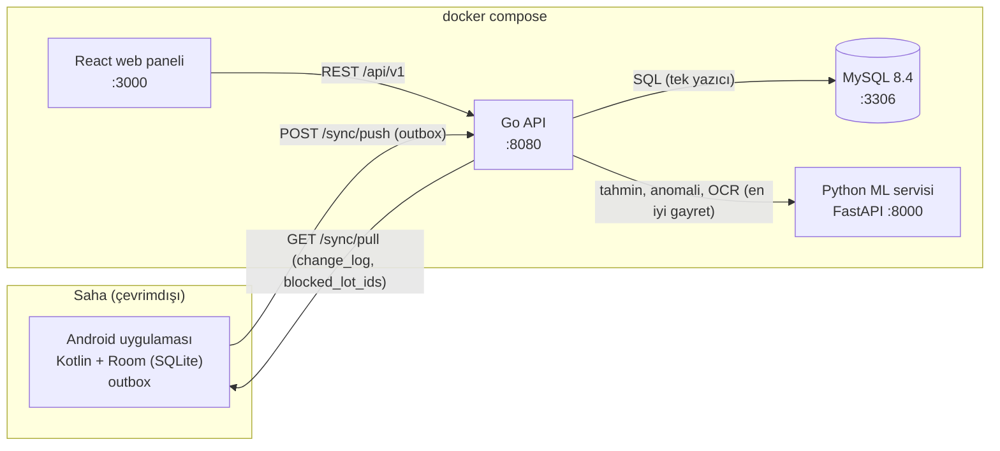

# Avatar: Üretim, Maliyet, Satış ve Lot İzlenebilirliği

[](https://github.com/summitman001/avatar-lot-izlenebilirlik/actions/workflows/ci.yml)

Gıda işletmesi için hammaddeden nihai satışa kadar maliyet ve lot izlenebilirliği sistemi. Dış hizmetle
üretilen mamulde gerçek miktara göre birim maliyet (EKP), bütün kuzu parçalamada maliyet dağıtımı,
çevrimdışı çalışan Android satış uygulaması ve hammaddeden markete kadar ileri/geri izleme ile geri
çağırma tek bir sistemde birleşir. Go API + MySQL, React yönetim paneli, Python ML servisi ve Kotlin
Android uygulamasından oluşur.

**Takım:** [TAKIM ADI] · **Üyeler:** Enes Altunbaş, Taha Efe Tuncer, Eren Sarı

[DEMO VİDEOSU](VIDEO_LINKI_BURAYA)

## İçindekiler

1. [Hızlı başlangıç](#1-hızlı-başlangıç)
2. [Demo senaryosu](#2-demo-senaryosu)
3. [Tespit edilen tutarsızlıklar](#3-tespit-edilen-tutarsızlıklar)
4. [Gereksinim-kanıt tablosu](#4-gereksinim-kanıt-tablosu)
5. [Mimari](#5-mimari)
6. [Temel tasarım kararları](#6-temel-tasarım-kararları)
7. [Senkronizasyon yaklaşımı](#7-senkronizasyon-yaklaşımı)
8. [Yapay zeka çalışmaları](#8-yapay-zeka-çalışmaları)
9. [Testler](#9-testler)
10. [Proje yapısı](#10-proje-yapısı)
11. [Bilinen sınırlamalar](#11-bilinen-sınırlamalar)
12. [Ekip ve katkılar](#12-ekip-ve-katkılar)

## 1. Hızlı başlangıç

### Ön koşullar

- **Docker Desktop** (`docker compose` eklentisiyle). Bu README, Docker Engine 29.9.2 ve Docker Compose
  5.6.1 ile Windows 11 üzerinde doğrulandı; CI'da `ubuntu-latest` üzerindeki Docker ile her commit'te
  çalışır. Eski, ayrı kurulan `docker-compose` (v1) ile denenmedi.
- **Disk:** imajlar yaklaşık 2,2 GB tutar (MySQL 8.4 1,1 GB, ML servisi 0,9 GB, diğerleri 0,2 GB);
  derleme önbelleği için ek alan gerekir. En az 5 GB boş alan önerilir.
- **Boş portlar:** `3000` (web), `8080` (API), `8000` (ML), `3306` (MySQL). Çakışma varsa
  `.env.example` dosyasını `.env` olarak kopyalayıp `WEB_PORT`, `API_PORT`, `ML_PORT`,
  `MYSQL_HOST_PORT` değerlerini değiştirin. `API_PORT` değişirse `VITE_API_URL` da aynı porta
  çekilmelidir (web build anında gömülür).

### Tek komut

```bash
docker compose up --build
```

Sıra kendiliğinden yürür: `mysql` (sağlıklı) → `migrate` (12 migration) → `seed` (demo verisi) → `api`
→ `web`; `ml` bağımsız başlar, `seed` onun sağlıklı olmasını bekler. Ek bir adım yoktur.

**Süre:** CI'daki `compose-smoke` job'unda boş bir makinede `docker compose up --build -d --wait`
**2 dakika 17 saniye** sürdü (main üzerindeki son çalıştırma, 31 Ekim 2026). Yerelde imajlar önbellekteyken
aynı komut 31 saniyede hazır oldu. İnternet hızına göre ilk derleme daha uzun sürebilir.

Hazır olunca tarayıcıda açın: **http://localhost:3000**

| Servis | Adres | Not |
|---|---|---|
| Web paneli | http://localhost:3000 | 14 menü: Dashboard, Ürünler, Lotlar, Stok Hareketleri, Alışlar, Fatura Okuma, Dış Üretim, Parçalama, Yeniden İşleme, Satış/Sevkiyat, İzlenebilirlik, Geri Çağırma, Tahminler, Uyarılar |
| Go API | http://localhost:8080/api/v1 | `GET /health`, sözleşme: http://localhost:8080/api/v1/openapi.yaml |
| ML servisi | http://localhost:8000 | `GET /health`, `GET /models`, FastAPI Swagger: http://localhost:8000/docs |
| MySQL | localhost:3306 | kullanıcı `app` / şifre `app`, veritabanları `avatar` (uygulama) ve `avatar_test` (testler) |

Hızlı kontrol (seed verisinin geldiğini gösterir):

```bash
curl "http://localhost:8080/api/v1/lots?has_mismatch=true"
```

Yanıtta `KZ-2026-001` lotu bulunmalıdır (alış belgesinde 287,50 € hesaplanan, 351,00 € beyan edilen).

### Android uygulaması

Repoda hazır APK yoktur; Android Studio (2025.3.4 veya daha yeni, Android SDK platform 37, JDK 21)
ile derlenir. Debug build varsayılan olarak backend'siz demo modu (FakeApi) ile çalışır; gerçek API'ye
bağlanmak için `useFakeApi=false` verin:

```bash
cd android
./gradlew assembleDebug -PuseFakeApi=false
adb install -r app/build/outputs/apk/debug/app-debug.apk
```

- **Emülatör** hosttaki API'ye `10.0.2.2` üzerinden erişir; varsayılan adres
  `http://10.0.2.2:8080/api/v1/` (`android/gradle.properties`). Emülatörde `localhost` emülatörün
  kendisidir.
- **Gerçek cihaz** için bilgisayarın yerel ağ IP'si verilir:
  `./gradlew assembleDebug -PuseFakeApi=false -PapiBaseUrl=http://192.168.1.20:8080/api/v1/`
- İlk açılışta **Senkron** sekmesinden cihaz deposu olarak `WH-MAIN` seçilmelidir (seed stoğu bu
  depodadır). Depo seçilmeden satış yapılamaz.

Ayrıntı: [android/README.md](android/README.md).

### Sorun giderme

- **Tam sıfırlama** (veritabanı ve yüklenen dosyalar silinir, seed yeniden yüklenir):

  ```bash
  docker compose down -v
  ```

  ```bash
  docker compose up --build
  ```

- Demo senaryosu temiz bir veritabanı varsayar. Daha önce geri çağırma başlattıysanız veya satış
  yaptıysanız sayılar değişir; yukarıdaki iki komutla sıfırlayın.
- Bir servisin neden kalkmadığını görmek için: `docker compose logs api` (veya `seed`, `migrate`, `ml`).
- `make` kullanılabiliyorsa `make reset` aynı sıfırlamayı yapar (Windows'ta `winget install ezwinports.make`).

## 2. Demo senaryosu

Tüm sayılar temiz bir `docker compose up --build` sonrasında canlı sistemden okunarak yazıldı. Web
panelinde tutarlar ekranın kendi biçimiyle (bazı ekranlarda ondalık ayırıcı nokta) gösterilir; aşağıda
ekranda görüleceği gibi yazılmıştır.

### Adım 1: Dış üretim maliyeti (URT-2026-045)

Sol menü **Dış Üretim** → `URT-2026-045` satırına tıklayın. **Maliyet Raporu** kartında:

| Alan | Ekranda görülmesi gereken |
|---|---|
| Dana Eti / Sucuk Baharatı / Bağırsak | `970.00 €` / `48.00 €` / `58.00 €` |
| Hizmet bedeli (85 adet × 5,50 €) | `467.50 €` |
| Toplam Maliyet | `1543.50 €` |
| EKP (birim) | `18.16 €` (4 ondalıklı değer `18,1588 €` üst kartta) |
| Ciro (85 × 24,90 €) / Brüt Kâr / Marj | `2116.50 €` / `573.00 €` / `%27.07` |

Aynı sayfada "Tahmin vs Gerçek" kartı ML tahminini (beklenen 84,49 adet, beklenen EKP 18,2353 €) gerçekle
karşılaştırır; "Hareket Zaman Çizelgesi" sevk, tüketim ve mamul girişi hareketlerini listeler. Ekran
görüntüsü (eski arayüz tasarımı, aynı sayılar):
[urt-2026-045-cost-report.jpg](docs/screenshots/urt-2026-045-cost-report.jpg)

### Adım 2: Parçalama ve iki dağıtım yöntemi (CUT-2026-001)

Sol menü **Parçalama** → `CUT-2026-001` (durum: Kapandı). Görülmesi gerekenler:

- Giriş kartı: `KZ-2026-001`, 25,000 kg, 11,5000 €/kg, **Hesaplanan Toplam `287,5000 €`**, **Beyan
  Edilen Toplam `351,0000 €`**, Kullanılan Esas: Hesaplanan, çözüm notu dolu.
- Ağırlık Dengesi: `25,000 / 25,000 kg (fark 0,000 kg)` (6 parça 22 kg + fire 3 kg).
- **Dağıtım Önizlemesi:** Miktar (kg) ve Değer (€) yöntemleri yan yana; **her iki tablonun Toplam
  satırı `287,50 €`**. Örnek: Kuzu But miktar yönteminde `98,01 €`, değer yönteminde `109,18 €`.
- Oluşan Lotlar: `KUZ-BUT-2026-001` … `KUZ-FIRE-2026-001` (7 lot; fire birim maliyeti `0,0000 €/kg`).

Ekran görüntüsü: [cutting-order-detail.jpg](docs/screenshots/cutting-order-detail.jpg)

### Adım 3: Dengesi tutmayan parçalama kapatılamaz (CUT-2026-003)

**Parçalama** → `CUT-2026-003` (durum: Taslak, rozet: "Ağırlık dengesi tutmuyor"). Fire satırı boş
bırakılmıştır:

- Ağırlık Dengesi: `19,360 / 22,000 kg (fark 2,640 kg)`
- Uyarı metni: "Denge tutmuyor (>0,05 kg fark), kapatılamaz."
- **Kapat** butonu devre dışı. Karşılaştırma için `CUT-2026-002` aynı lotla dengeli girilmiştir
  (fark 0,000 kg, Kapat butonu aktif, bilerek kapatılmamış).

### Adım 4: Alış belgesi tutarsızlığı (KZ-2026-001)

Sol menü **Alışlar**: üstteki "Tutar uyuşmazlığı" kartı `1` gösterir. `PR-KZ-2026-001` satırına
tıklayın (lot `KZ-2026-001`). Satırlar tablosunda:

| Miktar | Birim Fiyat | Hesaplanan Tutar | Beyan Edilen Tutar |
|---|---|---|---|
| 25.000 | 11.5000 € | `287.5000 €` | `351.0000 €` (kırmızı) |

Lot maliyeti hesaplanan birim fiyattan kurulur; hangi tutarın esas alınacağı parçalama emrinde
kararlaştırılır (adım 2). Ekran görüntüsü:
[alislar-uyusmazlik.jpg](docs/screenshots/alislar-uyusmazlik.jpg)

### Adım 5: İleri izleme (ET-2026-001)

Sol menü **İzlenebilirlik** → arama kutusuna `ET-2026-001` yazın ve öneriden seçin.

- Soy ağacı: `ET-2026-001` (100 kg dana eti) → `URT-2026-045` dış üretimi → `SUC-2026-045` (85 adet).
- **Etkilenen Lotlar (2):** `ET-2026-001` ve `SUC-2026-045`. `SUC-2026-045` için stokta kalan
  `2.000 adet` (iade edilenler), iade edilen `2.000 adet`.
- **Müşteri Dağılımı:** Market A `30.000`, Market B `25.000` (iade `2.000`), Market C `30.000`. İkinci
  kademe dağıtım sütunu "Bilinmiyor" (kayıt yok).
- Geri izleme: "Aramaya dön" ile `SUC-2026-045`'i arayıp **Geri İzleme** sekmesini açın: 3 hammadde
  lotu, 3 tedarikçi (`ET-2026-001` Palandöken Et Tedarik, `BHR-2026-001` Doğu Baharat, `BGR-2026-001`
  Anadolu Bağırsak).
- Bağımsız kontrol: `ET-2026-002` aranırsa aynı hammaddenin iki ayrı mamul lotuna (`SUC-2026-046`,
  `SUC-2026-047`) dağıldığı görülür; bu lotlar `ET-2026-001` izlemesinde yer almaz.

### Adım 6: Geri çağırma

Adım 5'teki ekranda **"Bu lottan geri çağırma başlat"** → bir sebep yazıp başlatın. `RCL-2026-001`
detayına yönlendirilirsiniz:

- **Etkilenen Lotlar (2):** `ET-2026-001` ve `SUC-2026-045`, durum "Bloke (geri çağrıldı)".
  `SUC-2026-046`/`SUC-2026-047` aktif kalır.
- **Müşteri / Market Tablosu (3 bekliyor):**

  | Müşteri | Lot | Sevk | İade | Kalan Risk |
  |---|---|---|---|---|
  | Market A | SUC-2026-045 | 30.000 | 0.000 | 30.000 |
  | Market B | SUC-2026-045 | 25.000 | 2.000 | 23.000 |
  | Market C | SUC-2026-045 | 30.000 | 0.000 | 30.000 |

- **İletişim Listesi (CSV)** butonu market adı, telefon, e-posta, lot, sevk, iade, kalan risk ve durum
  sütunlu bir CSV indirir.
- Müşteriler tek tek "Onaylandı" yapılmadan **Kapat** `422` ile reddedilir.
- Dashboard'da "Bloke Lot 2" ve "Aktif Geri Çağırma 1" görünür.

### Adım 7: Android çevrimdışı satış

Önkoşul: Android uygulaması gerçek API'ye bağlı (bkz. [Android uygulaması](#android-uygulaması)),
cihaz deposu `WH-MAIN`.

1. **Senkron** → "Şimdi senkronla": lotlar ve bakiyeler gelir. Adım 6'da geri çağrılan `SUC-2026-045`
   **Lotlar** ekranında kırmızıdır ve tıklanamaz; satış formunda seçilirse hata verir.
2. Emülatörü uçak moduna alın (üst bar "Çevrimdışı" gösterir). **Lotlar** → aktif bir lot
   (örneğin `SUC-2026-048`, 70 adet) → müşteri, miktar, fiyat → onaylayın. Satış Room'a ve outbox'a
   yazılır, üst bar "Bekleyen 1" gösterir.
3. Uçak modunu kapatıp **Senkron** → "Şimdi senkronla". Sonuç `applied` olur, üst bar "Güncel" olur.
4. Web panelinde **Satış/Sevkiyat** listesinde satış cihazın ürettiği `S-…` numarasıyla görünür; lotun
  **Stok Hareketleri**'nde `Satış` hareketi oluşur.
5. Geri çağrılan lota çevrimdışı satış (cihaz geri çağırmadan önce senkronlanmışsa mümkündür) sunucuda
   reddedilmez: `flagged` + `LOT_BLOCKED_AT_SALE` döner, Satış/Sevkiyat'ta "İhlal" rozeti, geri çağırma
   detayında ilgili markette "offline ihlal" rozeti çıkar ve marketin sevk miktarı artar.

Bu adımın sunucu tarafı (bloke lot satışında REST `422`, push'ta `flagged`, aynı `op_id` tekrarında
`duplicate`) canlı API'de, istemci tarafı Android testleriyle doğrulandı (bkz. [Testler](#9-testler)).

### Adım 8: Tahminler ve Uyarılar

- **Tahminler:** "Dış Üretim: Teslim Edilen Adet" kartı Kayıt `8`, Gerçeği Girilmiş `4`, MAE `5.5100`,
  MAPE `14.99%`; "Parçalama: Parça Ağırlığı (kg)" kartı Kayıt `3`, Gerçeği Girilmiş `1`, MAE `0.1590`,
  MAPE `4.62%`. Dış üretimde MAE'yi büyüten, bilerek düşük verimle kurulan `URT-2026-048` demo emridir
  (85 planlanan, 70 teslim). Ekran görüntüsü: [tahminler.jpg](docs/screenshots/tahminler.jpg)
- **Uyarılar:** Açık uyarı `6` (Kritik `5`, Uyarı `1`): `URT-2026-048` ve `URT-2026-047` için EKP
  sapması ve düşük verim, `CUT-2026-001` için yüksek fire, `PR-ET-2026-901` için maliyet artışı. Sayfa
  başlığı: "yalnızca bilgilendirir, işlemi durdurmaz". Ekran görüntüsü:
  [uyarilar.jpg](docs/screenshots/uyarilar.jpg)

İsteğe bağlı: **Fatura Okuma** → "Fatura/İrsaliye Yükle" ile
[docs/samples/invoice_mismatch.png](docs/samples/invoice_mismatch.png) yüklenirse OCR, `KZ-2026-001`
satırını okur (genel güven 0,93) ve `TUTAR_UYUSMAZLIGI: 25.000 x 11.50 = 287.50, okunan satir tutari
351.00` uyarısı verir. Onaylanmadan hiçbir kayıt oluşmaz. Ekran görüntüleri:
[fatura-okuma-oneri.jpg](docs/screenshots/fatura-okuma-oneri.jpg),
[fatura-okuma-sonuc-uyusmazlik.jpg](docs/screenshots/fatura-okuma-sonuc-uyusmazlik.jpg)

## 3. Tespit edilen tutarsızlıklar

Proje dokümanının örnek senaryolarında aşağıdaki tutarsızlıklar tespit edildi. Sistem hiçbirini sessizce
düzeltmez; her birini bir doğrulama kuralıyla yakalar ve ekranda gösterir. Ayrıntılı gerekçeler:
[docs/assumptions.md](docs/assumptions.md) ("Dokümandaki tutarsızlıklar") ve
[docs/cutting.md](docs/cutting.md) (bölüm 5).

### 3.1 25 kg × 11,50 € = 287,50 €, belgede 351,00 €

- **Tutarsızlık:** Bütün kuzu alışında miktar ve birim fiyat 287,50 € verir; belgede beyan edilen
  toplam 351,00 €'dur (351,00 / 25 = 14,04 €/kg, başka hiçbir alanla örtüşmez).
- **Nasıl yakalanır:** Alış satırında `line_total = round2(qty × unit_price)` hesaplanır, beyan edilen
  `declared_line_total` ile karşılaştırılır; fark varsa `has_mismatch = TRUE`. Parçalama emri açılırken
  aynı fark `PURCHASE_TOTAL_MISMATCH` uyarısı üretir ve `cost_basis` (`computed`/`declared`) ile
  `resolution_note` zorunlu olur; verilmezse `MISMATCH_RESOLUTION_MISSING` ve emir kapatılamaz.
  Fatura okumada OCR aynı farkı `TUTAR_UYUSMAZLIGI` uyarısıyla gösterir.
- **Nerede görünür:** Alışlar → `PR-KZ-2026-001` (kırmızı satır), Lotlar ("Tutar uyuşmazlığı" filtresi),
  Parçalama → `CUT-2026-001` giriş kartı, `GET /lots?has_mismatch=true`.
- **Karar:** Demo için **287,50 €** seçildi. Gerekçe: birim fiyat ve ağırlık birbiriyle tutarlı,
  hatalı görünen tek alan beyan edilen toplam. Seçilmeyen esas da `alternative_basis` altında
  hesaplanır; golden `KZ-2026-003` 351,00 € esasıyla dağıtımı gösterir. Gerçek iş kuralı yarışma
  sahibine teyit ettirilmelidir.

### 3.2 Parçaların toplamı 22 kg, giriş 25 kg (3 kg fark)

- **Tutarsızlık:** Örnekteki parça ağırlıkları 22 kg eder, karkas 25 kg'dır; 3 kg açıkta kalır.
- **Nasıl yakalanır:** `balance_diff_kg = giriş − Σ(parçalar + fire + yan ürün)`; `|fark| > 0,05 kg`
  ise `WEIGHT_IMBALANCE` ve `closable=false`. Kapatma isteği `422` döner.
- **Nerede görünür:** Parçalama detayında Ağırlık Dengesi çubuğu ve "kapatılamaz" uyarısı
  (`CUT-2026-003`). Golden: `KZ-2026-001-QTY/VAL` (fire yok, dengesiz), `KZ-2026-002-QTY/VAL`
  (3 kg fire ile dengeli).
- **Karar:** Farkın fire olduğu kabul edildi. Fire maliyet taşımaz, maliyeti satılabilir parçalara
  biner; ama defterde normal bir lot (`KUZ-FIRE-2026-001`) olarak kaydedilir ki "3 kg nereye gitti"
  sorusu defterden cevaplanabilsin. Seed'deki `CUT-2026-001` 3 kg fire ile kapatılmıştır.

### 3.3 18,16 × 85 = 1.543,60 €, gerçek toplam 1.543,50 €

- **Tutarsızlık:** Ekranda gösterilen EKP (18,16 €) ile adet çarpılınca 10 sent fazla çıkar.
- **Nasıl yakalanır:** Bu bir hata değil, gösterim yuvarlamasıdır. 18,16, 1.543,50 / 85 =
  18,158823… değerinin 2 ondalığa yuvarlanmış hâlidir.
- **Politika:** Her maliyet satırı ayrı ayrı 2 ondalığa yuvarlanır (ROUND_HALF_UP), toplam bu
  satırların toplamıdır. `ekp_unit` 4 ondalık (`18,1588`) saklanır ve değerleme yalnızca bununla veya
  `total_cost` ile yapılır; `ekp_display` (`18,16`) yalnızca gösterimdir. 18,1588 × 85 = 1.543,498 →
  1.543,50.
- **Nerede görünür:** Dış Üretim → `URT-2026-045` (üst kartta `18,1588 €`, maliyet raporunda
  `18.16 €`). Golden: `UR-004` (`rounding_proof`).

### 3.4 Örnek görselin proje dokümanında yer almaması

Proje dokümanı örnek bir görsele atıf yapar, ancak görsel dokümanda bulunmaz. Bu yüzden yorum yalnızca
metindeki sayılara dayandırıldı ve görselde olabilecek bilgiler varsayılmadı:

- Kuzu reçetesinin parça oranları metindeki 25 kg senaryosunun parça ağırlıklarından türetildi
  ([docs/golden/cutting_case.json](docs/golden/cutting_case.json)).
- Doküman parça satış fiyatı, raf ömrü ve sucuk satış fiyatı (VKP) vermediği için bunlar açıkça
  **varsayım** olarak işaretlendi: parça referans fiyatları 10 ile 18 €/kg arası, VKP 24,90 €
  ([docs/assumptions.md](docs/assumptions.md), "VKP varsayımı" ve "Raf ömrü ve parça satış fiyatı
  varsayımları"). Değişirlerse yalnızca ürün kaydı ve oracle sabiti güncellenir.
- Yan ürünlü senaryoda (golden `KZ-2026-004`) parça toplamını 22 kg'da tutmak için but ve kıyma
  ağırlıkları bilinçli olarak 0,5'er kg düşürüldü; bu sapma golden açıklamasında yazılıdır.

## 4. Gereksinim-kanıt tablosu

"Durum" sütunu: **Var** = çalışıyor ve kanıtı gösterildi; **Kısmen** = eksik yanı aynı satırda yazılı.
Test adları `backend/internal/integration/` (Go entegrasyon, gerçek MySQL), `backend/internal/domain/`
(Go birim), `ml/tests/` (Python) ve `android/app/src/test*/` (Kotlin) altındadır.

### Görev 1: Dış üretim ve maliyet

| Gereksinim | Durum | Nerede | Kanıt |
|---|---|---|---|
| Hammadde kartları, alış fiyatları, ölçü birimleri | Var | Ürünler (12 ürün; birim kg/adet, birim ağırlık, satış fiyatı, raf ömrü), `GET/POST/PUT /items` | `TestCreatePurchaseReceiptMultiLine`, [api-contract.md](docs/api-contract.md) |
| Lot numaraları ve stoklar | Var | Lotlar (eldeki miktar, durum), `GET /lots`, `v_lot_balance` | `TestListLotsFilters`, `TestCreateLotCreatesMovementAtomically` |
| Dış üretim emri | Var | Dış Üretim → Yeni Sipariş, `POST /production-orders` | `TestProductionOrderFullLifecycle`, `TestProductionOrderNumberingIsAtomicUnderConcurrency` |
| Hammadde sevki | Var | Sipariş detayı, `POST /production-orders/{id}/send-materials` | `TestProductionBlockedLotCannotBeShipped`, `TestProductionInsufficientBalanceRejected` |
| Hizmet maliyeti | Var | Maliyet raporunda "Hizmet bedeli", faturalanan adet üzerinden | golden `UR-003`, `TestProductionGoldenScenarios` |
| Mamul kabulü | Var | `POST /production-orders/{id}/receive` (iade destekli), çıktı lotu `SUC-…` | `TestProductionPartialReturn`, `TestProductionOrderFullLifecycle` |
| Miktar farkları | Var | `QTY_VARIANCE` (%2 eşik), `INVOICED_QTY_MISMATCH`; listede "Miktar sapması" rozeti (`URT-2026-048`) | golden `UR-002`, `UR-003` |
| Gerçek miktara göre EKP, VKP, brüt kâr, marj | Var | Dış Üretim detayı → Maliyet Raporu, `GET /production-orders/{id}/cost-report` | golden `UR-001`…`UR-006`, `TestGoldenProduction`, `ml/tests/test_hand_verified.py` |
| Geçmişe dönük inceleme | Var | Kapanmış emirlerin detayı, durum geçmişi, hareket zaman çizelgesi, Tahminler sayfası | `GET /production-orders/{id}/movements`, [urt-2026-045-cost-report.jpg](docs/screenshots/urt-2026-045-cost-report.jpg) |

### Görev 2: Parçalama, satış, Android

| Gereksinim | Durum | Nerede | Kanıt |
|---|---|---|---|
| Parçalama reçetesi ve dağıtım anahtarının önceden tanımlanması | Kısmen | Reçete (oran + referans satış fiyatı) `POST/PUT /cutting-recipes` ile tanımlanır; yöntem (miktar/değer) emir açılırken seçilir. **Web'de reçete düzenleme ekranı yok, yalnızca API.** | `TestCuttingRecipeRatioValidation`, seed `REC-KUZU-01` |
| Giriş hayvanı/partisi, ağırlık, alış maliyeti, işlem tarihi | Var | Parçalama → Yeni emir; giriş kartı (lot, kg, €/kg, tarih) | `TestCuttingOrderFullLifecycleAndTraceability` |
| Parça ürünleri, fire/yan ürün, ağırlık dengesi | Var | Fiili Ağırlıklar tablosu, Ağırlık Dengesi çubuğu | golden `KZ-2026-001`…`006`, `TestCuttingOrderCloseRequiresWeightBalance` |
| Maliyet dağıtımı ve toplam eşitliği | Var | Dağıtım Önizlemesi (iki yöntem yan yana, toplam = giriş maliyeti) | `TestDistributeSumsExactly`, `test_dagitim_toplami_maliyete_esit` (hypothesis), golden `KZ-2026-005` |
| Parçaların lot bazında stoklanması | Var | Kapanışta parça başına lot (`KUZ-BUT-2026-001` …) + `cutting_in` | `TestCuttingOrderFullLifecycleAndTraceability` |
| Parçaların Kotlin'den satılması | Var | Android satış (kg bazlı parça lotları); seed'de `SAT-2026-001` 5 kg `KUZ-BUT-2026-001` | `TestSyncDeviceSaleRules`, `SyncRepositoryTest` |
| Hammadde girişinde tedarikçi, lot, tarih, miktar, SKT | Var | Alışlar → Yeni Alış (SKT verilmezse raf ömründen türetilir) | `TestPurchaseLotExpiryDerivedFromShelfLife`, `TestCreatePurchaseReceiptMultiLine` |
| Satış/sevkiyat/iade | Var | Satış/Sevkiyat (liste, yeni satış, detayda iade), `POST /sales-orders`, `POST /customer-returns` | `TestSalesOrderRestFlow`, `TestCustomerReturn`, `TestSalesScenarioThreeWaySplit` |

### Görev 3: İzlenebilirlik ve geri çağırma

| Gereksinim | Durum | Nerede | Kanıt |
|---|---|---|---|
| Çoktan çoğa lot ilişkileri | Var | `lot_link` tablosu; `SUC-2026-045` ← 3 hammadde lotu, `ET-2026-002` → 2 mamul lotu | `TestTraceForwardMultiPathAndCustomerSummary`, `TestTraceBackwardThreeRawLotsThreeSuppliers` |
| Parçalamada lot bağlantısı | Var | Kapanışta her parça için `lot_link (cutting)` | `TestCuttingOrderFullLifecycleAndTraceability` |
| Depo transferi | Var | Lotlar → Transfer, `POST /stock-transfers` | `TestStockTransfer` |
| Satış ve iade hareketleri | Var | `sale_out`, `return_in`; Stok Hareketleri | `TestSalesOrderRestFlow`, `TestCustomerReturn` |
| Yeniden işleme | Var | Yeniden İşleme sayfası, `POST /reprocess-orders` | `TestReprocessOrder`, `TestReprocessKeepsEarliestInputExpiry` |
| Fire hareketi | Var | Lotlar → Fire, `POST /lots/{id}/waste` (`waste_out`) | `TestRecordWaste` |
| İleri izleme | Var | İzlenebilirlik → İleri İzleme, `GET /lots/{id}/trace-forward` | `TestTraceForwardThreeLevelsDeep`, `TestTraceForwardCycleGuard` |
| Geri izleme | Var | İzlenebilirlik → Geri İzleme, `GET /lots/{id}/trace-backward` | `TestTraceBackwardThreeRawLotsThreeSuppliers`, `TestGenealogyLevelsAndEdges` |
| Geri çağırma ekranı ve bloke | Var | Geri Çağırma (liste/detay), `POST /recalls`; etkilenen tüm lotlar `recalled` | `TestRecallCreateBlocksOnlyAffectedLots`, `TestRecallCloseRequiresAllCustomersConfirmed` |
| Müşteri bazlı liste | Var | Müşteri/Market tablosu + İletişim Listesi (CSV), `GET /recalls/{id}/contact-list?format=csv` | `TestRecallContactListCSV`, `TestRecallLateOfflineSaleUpdatesCustomerList` |
| İkinci kademe dağıtım kuralı (yalnızca kayıtlıysa kesin) | Var | Kayıt yoksa "Bilinmiyor"; Geri Çağırma detayında "+" ile kayıt, `POST /downstream-distributions` | `TestDownstreamDistributionShownOnlyWhenRecorded`, `TestDownstreamForSaleWithoutShipment` |
| Kotlin satış satırının lotu | Var | Her satış satırı `lot_id` taşır (FEFO önerili seçim) | `SaleValidatorTest`, `SalesRepositoryTest` |
| Geri çağrılan lotun satışının engellenmesi | Var | Android'de bloke lot tıklanamaz; REST satış `422`; çevrimdışı satış `flagged` + `recall_violation` | `LotsScreenTest`, `SyncRepositoryTest`, `TestSalesOrderRestBlockedLot422`, `TestRecallBlockReflectedInSyncAndOfflineViolation` |

### Yapay zeka

| Gereksinim | Durum | Nerede | Kanıt |
|---|---|---|---|
| Zorunlu A: mamul miktarı ve EKP tahmini | Var | `POST /predict/production` + Go'da hibrit EKP; Dış Üretim detayında "Tahmin vs Gerçek". Aktif model baseline (öğrenen modeller geçemedi, bkz. [bölüm 8](#8-yapay-zeka-çalışmaları)) | `TestProductionHybridEkpPrediction`, `TestProductionMLUnreachableStillCreatesOrder`, [ml-report.md](docs/ml-report.md) |
| Zorunlu B: parça ağırlığı/oranı tahmini | Var | `POST /predict/cutting`; Parçalama detayında "ML Tahmini" sütunu; aktif model `cutting_ridge_multi` | `ml/tests/test_models.py`, [ml-report.md](docs/ml-report.md) |
| Baseline karşılaştırma ve hata ölçümü | Var | `GET :8000/models`, Tahminler sayfası (MAE/MAPE), `GET /predictions/summary` | `ml/tests/test_evaluate.py`, `TestPredictionsListAndSummary`, [ml/reports/model_comparison.json](ml/reports/model_comparison.json) |
| Veri azlığı sınırlılıkları | Var | Öğrenme eğrisi, sınırlılıklar bölümü | [ml-report.md](docs/ml-report.md) bölüm 5 ve 7, [ml-data.md](docs/ml-data.md) |
| İsteğe bağlı: fatura okuma | Var | Fatura Okuma (öneri → düzeltme → onay), `POST /invoice-imports` | `TestInvoiceImportConfirmCreatesReceiptLotAndMovement`, `ml/tests/test_ocr.py`, [invoice-ocr.md](docs/invoice-ocr.md) |
| İsteğe bağlı: anomali tespiti | Var | Uyarılar, Dashboard, detay kartları, `GET /anomaly-alerts` | `TestProductionAnomalyDetectedWhenMLUp`, `TestNegativeStockRuleIndependentOfML`, `ml/tests/test_anomaly.py`, [anomaly-integration.md](docs/anomaly-integration.md) |

### Teknik gereksinimler

| Gereksinim | Durum | Nerede | Kanıt |
|---|---|---|---|
| Kotlin + SQLite (mobil) | Var | `android/` (Kotlin 2.4, Compose, Room) | `MigrationTest`, `SalesRepositoryTest`, CI `android-test` |
| MySQL (merkez) | Var | MySQL 8.4, 12 migration | `TestMigrationsUpDownUp`, [data-model.md](docs/data-model.md) |
| Go (API) | Var | `backend/` (Go 1.23, chi, database/sql) | CI `backend-test` |
| React (web) | Var | `web/` (React 18, Vite, TypeScript, Mantine) | CI `web-build` (tip kontrolü + build) |
| ML servisi | Var | `ml/` (Python 3.11, FastAPI, scikit-learn) | CI `ml-test`, `ml-docker-build` |
| SQLite-MySQL senkron yaklaşımının açıklanması | Var | [bölüm 7](#7-senkronizasyon-yaklaşımı) | [sync.md](docs/sync.md), [android-integration.md](docs/android-integration.md) |

### Raporlar (altı rapor)

Raporlar web panelinde filtrelenebilir ekranlar olarak sunulur. Dosyaya dışa aktarma yalnızca geri
çağırma iletişim listesinde (CSV) vardır.

| Rapor | Durum | Nerede | Kanıt |
|---|---|---|---|
| Alış | Var | Alışlar (tedarikçi/uyuşmazlık filtresi, belge detayı) | [alislar-uyusmazlik.jpg](docs/screenshots/alislar-uyusmazlik.jpg), `TestListPurchaseReceiptsFilters` |
| Üretim | Var | Dış Üretim → Maliyet Raporu | [urt-2026-045-cost-report.jpg](docs/screenshots/urt-2026-045-cost-report.jpg) |
| Parçalama | Var | Parçalama detayı (dağıtım karşılaştırması, oluşan lotlar, hareketler) | [cutting-order-detail.jpg](docs/screenshots/cutting-order-detail.jpg) |
| Lot hareketleri | Var | Stok Hareketleri, Lotlar → Hareketler, `GET /stock-movements` | `TestStockMovementIsImmutable` |
| Satış | Var | Satış/Sevkiyat (liste, ihlal filtresi, detay) | `TestSalesOrderRestFlow` |
| Geri çağırma | Var | Geri Çağırma detayı + CSV | `TestRecallContactListCSV` |

### Teslimat kalemleri

| Kalem | Durum | Nerede |
|---|---|---|
| Çalışan prototip | Var | `docker compose up --build` (CI `compose-smoke` her commit'te doğrular) |
| Kaynak kod | Var | Bu repo |
| Kurulum | Var | [Hızlı başlangıç](#1-hızlı-başlangıç), [android/README.md](android/README.md) |
| Veri modeli | Var | [docs/data-model.md](docs/data-model.md) (ER diyagramı) |
| API açıklaması | Var | [backend/api/openapi.yaml](backend/api/openapi.yaml), [docs/api-contract.md](docs/api-contract.md) |
| Örnek kayıtlar | Var | Seed verisi (`backend/cmd/seed`), [ml/data/out/](ml/data/out/) (sentetik ML verisi), [docs/samples/](docs/samples/) (örnek faturalar), [docs/golden/](docs/golden/) |
| Otomatik testler | Var | [Testler](#9-testler) |

## 5. Mimari



Yalnızca Go API veritabanına yazar. ML servisi veritabanına erişmez; Go onu tahmin, anomali ve fatura
okuma için çağırır ve kapalı olması (fatura okuma hariç) hiçbir işlemi bozmaz.

| Bileşen | Teknoloji | Neden |
|---|---|---|
| Mobil | Kotlin 2.4, Jetpack Compose, Room, WorkManager, Hilt, Retrofit | Room SQLite üzerinde tip güvenli sorgu ve migration verir; WorkManager bağlantı geldiğinde senkronu garanti eder. |
| API | Go 1.23, chi, `database/sql`, `shopspring/decimal`, golang-migrate (ORM yok) | Para hesabında decimal tipi zorunlu tutulabilir, SQL ve transaction sınırları açıkça görünür. |
| Veritabanı | MySQL 8.4 | `WITH RECURSIVE` ile soy ağacı sorgusu, trigger ile değiştirilemez defter, `DECIMAL` tipleri. |
| Web | React 18, Vite, TypeScript, TanStack Query, React Router, Mantine | Tip kontrollü istemci, sunucu durumunu önbellekleyen sorgu katmanı, hazır form/tablo bileşenleri. |
| ML | Python 3.11, FastAPI, scikit-learn, Tesseract | Model eğitimi ve değerlendirme ekosistemi Python'da; maliyet oracle'ı da aynı dilde `Decimal` ile yazıldı. |

### Veri modeli

Tablolar ve ER diyagramı: [docs/data-model.md](docs/data-model.md). Tüm id'ler UUIDv7, tutarlar
`DECIMAL(14,4)`, miktarlar `DECIMAL(14,3)`. En kritik beş tablo:

- **`lot`**: her parti (alış, üretim çıktısı, parça, yeniden işleme). Ürün, tedarikçi, köken
  (`origin_type`), başlangıç miktarı, birim maliyet, SKT ve durum (`active|blocked|recalled|consumed`).
  Bakiye burada saklanmaz.
- **`lot_link`**: soy ağacının kenarları. Her satır "şu lottan şu kadar miktar, şu işlemle şu lota
  geçti" der (`parent_lot_id`, `child_lot_id`, `qty_from_parent`, `process_type`). Çoktan çoğa ilişki
  buradadır.
- **`stock_movement`**: değiştirilemez stok defteri. Her giriş/çıkış lot ve depo bazında bir satırdır;
  bakiye `v_lot_balance` görünümünde bu satırların toplamıdır.
- **`production_order`** (+ `production_input`): dış üretim emri, sevk edilen lotlar, teslim alınan ve
  faturalanan adet, hizmet fiyatı, çıktı lotu. Durum makinesi `draft → materials_sent → received → closed`.
- **`cutting_order`** (+ `cutting_output`): parçalama emri, giriş lotu ve ağırlığı, sabitlenen toplam
  maliyet, maliyet esası ve çözüm notu, dağıtım yöntemi, parça başına fiili ağırlık ve dağıtılan maliyet.

### API

Makine okunur sözleşme [backend/api/openapi.yaml](backend/api/openapi.yaml) (OpenAPI 3.1, 62 yol, 83
işlem). Çalışan sistemde aynı dosya http://localhost:8080/api/v1/openapi.yaml adresinden alınabilir; Go
API'de Swagger arayüzü yoktur (dosya https://editor.swagger.io gibi bir araca yüklenebilir). ML servisinin
etkileşimli belgesi http://localhost:8000/docs adresindedir. Örnek istek/yanıtlar ve kurallar:
[docs/api-contract.md](docs/api-contract.md).

## 6. Temel tasarım kararları

**Değiştirilemez stok defteri.** `stock_movement` tablosunda `BEFORE UPDATE` ve `BEFORE DELETE`
trigger'ları hata fırlatır; uygulama hatalı olsa bile kayıt değişmez. İşaret kuralı (giriş +, çıkış −)
CHECK ile zorlanır. Düzeltme yalnızca ters kayıtla yapılır (`POST /stock-movements/{id}/reverse`), bir
hareket en fazla bir kez geri alınabilir (`UNIQUE reverses_movement_id`) ve geri alma stoğu negatife
düşürecekse reddedilir. Bakiye ayrıca saklanmadığı için defterle çelişemez. Testler:
`TestStockMovementIsImmutable`, `TestStockMovementSignRule`, `TestReverseRefusesNegativeStock`.

**Para ve miktarda float yok.** Go'da `shopspring/decimal`, Python'da `Decimal` (float girdi
`TypeError`), Kotlin'de `BigDecimal`, MySQL'de `DECIMAL`. JSON'da tüm decimal değerler string taşınır;
API JSON number'ı ve fazla ondalığı reddeder. Ölçekler: miktar 3, birim maliyet 4, tutar 2, yüzde 2
ondalık, hepsi ROUND_HALF_UP. Maliyet satırları tek tek 2 ondalığa yuvarlanıp toplanır, böylece
satırların toplamı her zaman toplam maliyete eşittir. Dağıtımda her pay 2 ondalığa yuvarlanır ve
**kalan kuruş farkı en büyük tutarlı satıra eklenir** (eşitlikte girdi sırasındaki ilk satır); dağıtılan
toplam giriş maliyetine kuruşu kuruşuna eşittir (golden `KZ-2026-005`: 100,00 € / 3 = 33,34 + 33,33 + 33,33).

**`lot_link` ile çoktan çoğa soy ağacı.** Lot tablosunda tek bir `parent_id` yerine ayrı bir kenar
tablosu kullanılır; bir mamul birden çok hammaddeden, bir hammadde birden çok mamule gidebilir. İleri ve
geri izleme MySQL 8 `WITH RECURSIVE` ile bu tablo üzerinde gezinir; ziyaret edilen yol `path` sütununda
tutulup `FIND_IN_SET` ile döngü engellenir. Dış üretim, parçalama ve yeniden işleme aynı tabloya yazar,
bu yüzden izleme yeni işlem türleri için ek kod gerektirmez. Ayrıntı:
[docs/traceability.md](docs/traceability.md).

**Offline-first senkron.** Android'de her yazma tek bir Room transaction'ıdır: satış satırları, yerel
stok hareketi ve outbox kaydı birlikte yazılır, ağ çağrısı yoktur. Kimlikler istemcide UUIDv7 olarak
üretilir, sunucu aynen kullanır. Her işlem bir `op_id` (idempotency anahtarı) taşır. Stok ve geri
çağırma durumunun otoritesi sunucudur; cihaz kendi bakiyesini her pull'da sunucunun değeriyle düzeltir.

**Çevrimdışı satış reddedilmez, işaretlenir.** Satış cihazda fiziksel olarak zaten gerçekleşmiştir;
sunucu reddederse kayıt kaybolur ve stok defteri gerçeği yansıtmaz. Bu yüzden bloke/geri çağrılmış lot
satışı veya yetersiz stok `flagged` olarak kaydedilir (`sales_line.recall_violation`, negatif stok için
`anomaly_alert`), geri çağırma müşteri listesi otomatik güncellenir ve kapalı geri çağırma yeniden
açılır. Yalnızca bozuk istekler ve cihazın satamayacağı ürün/depo (`DEVICE_SALE_ITEM_TYPE`,
`DEVICE_SALE_WAREHOUSE`) `rejected` olur. Web'den (REST) yapılan satışta aynı kurallar sert hatadır
(`422`/`409`).

**İzlenebilirlik ve geri çağırma ML'den bağımsızdır.** `repo/traceability.go` ML istemcisine hiç
referans vermez; sonuçlar yalnızca kayıt ilişkilerinden (`lot_link`, satış, sevkiyat, iade) hesaplanır.
İzlenebilirlik entegrasyon testleri ML istemcisi bağlanmadan çalışır ve geçer.

**Anomali uyarıları karar değil bilgilendirmedir.** Hiçbir uyarı lotu bloke etmez veya işlemi
reddetmez; Uyarılar sayfası ve detay kartları bunu açıkça yazar. Bloke etme kararı yalnızca kullanıcının
(Blokla) veya geri çağırmanın sonucudur. Test: `TestCuttingMassBalanceRuleDedupAndNoBlock`.

**Maliyet hesapları iki bağımsız uygulamada doğrulanır.** Kurallar önce Python'da bir referans
"oracle" olarak yazıldı (`ml/oracle`), elle hesaplanan değerlerle (`test_hand_verified.py`) ve
özellik tabanlı testlerle (hypothesis) doğrulandı. Oracle'ın ürettiği golden dosyalar
([docs/golden/](docs/golden/)) Go'nun hem saf hesap fonksiyonlarıyla hem gerçek HTTP uç noktalarıyla
JSON birebir karşılaştırılır. CI golden dosyalarının oracle çıktısıyla güncel olduğunu da kontrol eder.

## 7. Senkronizasyon yaklaşımı

Android (Room/SQLite) ile MySQL arasında iki yönlü senkron vardır. Tam sözleşme:
[docs/sync.md](docs/sync.md); Kotlin tarafı: [docs/android-integration.md](docs/android-integration.md).

- **Outbox:** cihaz çevrimdışıyken her satış/iade yerel tablolara ve `sync_outbox`'a aynı transaction'da
  yazılır. WorkManager bağlantı varken 15 dakikada bir, uygulama açılışında ve her satıştan sonra
  senkron başlatır.
- **UUIDv7 ve idempotency:** kayıt id'leri ve her işlemin `op_id`'si cihazda UUIDv7 olarak üretilir.
  Sunucu `op_id`'yi `processed_request` tablosunda birincil anahtar olarak tutar; aynı işlem ikinci kez
  gelirse uygulanmaz, stok iki kez düşmez.
- **Push** (`POST /sync/push`): en fazla 500 işlem, sırayla ve her biri kendi transaction'ında işlenir;
  biri hata verirse diğerleri etkilenmez. Yanıt her zaman `200`, sonuç işlem bazındadır.
- **Pull** (`GET /sync/pull?since_seq=`): sunucudaki her değişiklik `change_log`'a artan `seq` ile
  yazılır. Cihaz son `next_seq`'i saklar, `has_more` bitene kadar çeker. Lot kayıtları güncel bakiyeyi
  (`qty_on_hand`, depo kırılımı) içerir. Push pull'dan önce yapılır, böylece cihaz kendi satışının
  bakiyeye etkisini aynı turda görür.

| Sonuç | Anlamı | Cihaz davranışı |
|---|---|---|
| `applied` | Uygulandı, kural ihlali yok | Outbox kaydını siler |
| `duplicate` | Bu `op_id` daha önce işlendi, tekrar uygulanmadı | Siler |
| `flagged` | Kaydedildi ama inceleme gerekiyor (`LOT_BLOCKED_AT_SALE`, `NEGATIVE_STOCK_OFFLINE`) | Siler ve kullanıcıya uyarı gösterir |
| `rejected` | Geçersiz, hiçbir kayıt yazılmadı | Outbox'ta tutar, hatayı gösterir; kullanıcı "Vazgeç" derse yerel stok etkisi geri alınır |

**Çakışma yönetimi:** ana veri (ürün, müşteri, depo) yalnızca sunucuda oluşur, cihaz yalnızca okur; bu
yüzden ana veri çakışması oluşmaz. Satış çakışmalarında (aynı lotu iki cihaz satarsa) sunucu satışı
kaydeder, stok negatife düşerse işaretler; karar insana bırakılır. Satılandan fazla iade her zaman
reddedilir (iade için çevrimdışı tolerans yoktur).

**Geri çağırma bilgisinin cihaza ulaşması:** her pull yanıtı `blocked_lot_ids` alanında durumu
`blocked` veya `recalled` olan **tüm** lotların tam listesini taşır. Cihaz yerel listeyi bununla
değiştirir; bu lotlar satış ekranında kırmızı ve seçilemez olur. Cihaz bunu görmeden satarsa yukarıdaki
`flagged` kuralı devreye girer.

## 8. Yapay zeka çalışmaları

Tam rapor, grafikler ve sınırlılıklar: [docs/ml-report.md](docs/ml-report.md). Veri üreteci:
[docs/ml-data.md](docs/ml-data.md).

### Ne tahmin ediliyor

- **Zorunlu A (dış üretim):** ML, et miktarı, tedarikçi, dış üretici, ay (mevsim), lot yaşı ve
  baharat/bağırsak oranından **fiziksel verimi** (çıktı kg / et kg) ve buradan teslim edilecek adedi
  tahmin eder. ML fiyat bilmez; **EKP tahmini hibrittir**: Go, ML'in adet tahminini sevk edilmiş
  hammaddenin **kesin** maliyetiyle birleştirir:
  `predicted_ekp = (material_cost + round2(predicted_qty × hizmet_fiyatı)) / predicted_qty`.
  Tahmin iki aşamada alınır (`draft`: yalnızca adet; `materials_sent`: adet + EKP), önceki satırın
  üzerine yazılmaz, mamul kabulünde gerçekleşenle karşılaştırılır.
- **Zorunlu B (parçalama):** karkas ağırlığı, ırk, cinsiyet ve ırk × ağırlık etkileşiminden parça
  başına (but, kol, sırt, kaburga, gerdan, kıyma, fire) oran tahmin edilir; tahminler toplamı karkasa
  eşit olacak şekilde normalize edilir.

### Değerlendirme

Tek bir train/test bölmesi kullanılmadı. Üretimde zaman sıralı **rolling-origin CV** (8 katman, sızıntı
yok), parçalamada **5-fold CV**. Model ile baseline'ın katman bazında hataları **eşleştirilmiş t-testi**
ile karşılaştırıldı. Sonuçlar (canlı `GET http://localhost:8000/models` çıktısıyla aynı):

| Görev | Model | MAE | MAPE | Baseline'a göre | p değeri |
|---|---|---|---|---|---|
| A (adet) | `production_baseline_supplier_mean` | **1,0835** | %1,31 | | |
| A | `production_ridge` | 1,1401 | %1,38 | %5,23 daha kötü | 0,249 |
| A | `production_gbm` | 1,2449 | %1,51 | %14,89 daha kötü | 0,237 |
| B (kg) | `cutting_baseline_breed_mean` | 0,0634 | %2,29 | | |
| B | `cutting_ridge_multi` | **0,0530** | **%1,98** | %16,40 daha iyi | **0,0096** |
| B | `cutting_gbm_multi` | 0,0556 | %2,07 | %12,36 daha iyi | 0,0111 |

Hibrit EKP hatası (görev A): baseline ile ortalama 0,1627 € (MAPE %0,91), Ridge 0,1713 €, GBM 0,1861 €.

**Sonuçlar dürüstçe:**

- **Görev A'da hiçbir öğrenen model baseline'ı geçemedi.** Fark anlamlı da değil (p > 0,2). Bu yüzden
  **aktif model tedarikçi ortalamasına dayanan baseline olarak bırakıldı**. Olası neden: üreteçteki
  verim etkileri küçük (en büyüğü ±0,02) ve gürültüye (σ = 0,012) yakın; 120 kayıt bu etkileri
  gürültüden ayırmaya yetmiyor, en güçlü tek etkiyi (tedarikçi) baseline zaten yakalıyor.
- **Görev B'de Ridge baseline'ı anlamlı şekilde geçti** (%16,4, p = 0,0096) ve aktif modeldir. Ancak
  bunun bir kısmı, Ridge'in özellik kümesinin üretecin kendi doğrusal yapısına (ırk × ağırlık) birebir
  oturmasından kaynaklanır; gerçek veride aynı başarı garanti değildir.
- Tahminler sayfasındaki seed kayıtlarında görülen yüksek dış üretim MAE'si (5,51 adet) model
  performansı değildir: anomali demosu için bilerek düşük verimle kurulan `URT-2026-048` ve küçük
  `URT-2026-047` emirlerinden gelir.

### Sentetik veri

Yarışmada gerçek işletme verisi sağlanmadığı için veri sentetiktir: 120 dış üretim emri (seed
`20250101`) ve 200 kuzu (seed `20260101`), sabit seed ile tekrar üretilebilir
([ml/data/out/](ml/data/out/)). Etkiler ve gürültü düzeyleri seçilmiş varsayımlardır; ML başarısını
güzelleştirmek için gürültü azaltılmadı, üreteç modele yaklaştırılmadı. Sınırlılıklar: metrikler
gerçek dünya performansını kanıtlamaz; model üretecin kurduğu yapıyı yeniden keşfeder; az veriyle
(5 ile 20 kayıt) tahminler güvenilmez (öğrenme eğrisi). Gerçek veriye geçiş için asgari kayıt sayıları
raporun 8. bölümündedir.

### İsteğe bağlı özellikler

- **Anomali tespiti:** 5 ML kuralı (`VERIM_DUSUK`, `FIRE_YUKSEK`, `MALIYET_ARTISI`, `EKP_SAPMA`,
  `KUTLE_DENGESI`) ve ML'den bağımsız iki kural (`KUTLE_DENGESI` deterministik kontrolü,
  `NEGATIVE_STOCK_OFFLINE`). Uyarılar yalnızca bilgilendirir. Ayrıntı:
  [docs/anomaly-integration.md](docs/anomaly-integration.md).
- **Fatura/irsaliye okuma:** Tesseract OCR + kural tabanlı alan çıkarımı (model eğitimi yok), alan başı
  güven puanı ve kaynak metin, ürün/tedarikçi için benzerlik eşleştirmesi. **İnsan onayı zorunludur:**
  OCR yalnızca öneri üretir, kullanıcı düzeltip onaylamadan hiçbir lot, stok hareketi veya alış fişi
  oluşmaz; onay, elle alış girişiyle aynı yazma yolunu kullanır. Ayrıntı:
  [docs/invoice-ocr.md](docs/invoice-ocr.md).

## 9. Testler

### Nasıl çalıştırılır

Go testleri gerçek MySQL ister; `make test` MySQL konteynerini ve `avatar_test` veritabanını kendisi
hazırlar (geliştirme verisine dokunmaz, adı `_test` ile bitmeyen veritabanında çalışmayı reddeder).

```bash
make test
```

```bash
make lint
```

`make` yoksa eşdeğeri:

```bash
docker compose up -d --wait mysql
docker compose run --rm test-db
export TEST_DATABASE_URL='app:app@tcp(127.0.0.1:3306)/avatar_test?parseTime=true&loc=UTC&multiStatements=true'
cd backend && go test -count=1 ./...
```

`TEST_DATABASE_URL` verilmezse entegrasyon testleri atlanır (yalnızca birim testleri koşar).

ML testleri (OCR testleri için Tesseract ve Türkçe dil paketi kurulu olmalı):

```bash
cd ml && pip install -r requirements.txt -r requirements-dev.txt && pytest
```

Android testleri (Android SDK gerekir):

```bash
cd android && ./gradlew assembleDebug test
```

Android'in gerçek Go API'ye karşı uçtan uca testi yalnızca `E2E_API_URL` verilince koşar:
`E2E_API_URL=http://127.0.0.1:8080/api/v1/ ./gradlew testDebugUnitTest --tests '*RealBackendSyncTest*'`

### Kapsam ve sayılar

| Paket | Test sayısı | Ne doğrular |
|---|---|---|
| Go `internal/domain` | 8 test fonksiyonu (golden senaryolar alt test olarak) | Golden karşılaştırması (`TestGoldenProduction`: 6 senaryo, `TestGoldenCutting`: 11 senaryo), decimal JSON kuralları, yuvarlama ve dağıtım |
| Go `internal/integration` | 85 test fonksiyonu, gerçek MySQL + HTTP | Migration up/down/up, trigger, atomik numaralandırma, dış üretim yaşam döngüsü, parçalama, satış ve senkron, izlenebilirlik ve geri çağırma, transfer/fire/yeniden işleme, anomali, fatura okuma |
| Python `ml/tests` | 131 test (parametrik durumlar dahil; son CI çalıştırmasında 131 geçti) | Oracle elle hesap kontrolleri, hypothesis özellik testleri, veri üreteci tekrarlanabilirliği, CV protokolü, modeller, API, anomali, OCR |
| Kotlin `android/app/src/test*` | 33 test (+2 gerçek API testi) | UUIDv7, decimal, satış kuralları, Room transaction'ları, migration, FakeApi ile senkron, bloke lot UI |
| Web | otomatik test yok | Yalnızca TypeScript tip kontrolü ve build |

### Golden dosya yaklaşımı

Maliyet kuralları önce Python'da bağımsız bir referans uygulama olarak yazıldı (`ml/oracle`). Oracle
[docs/golden/](docs/golden/) altındaki JSON dosyalarını üretir: `production_cases.json` (6 senaryo,
`UR-001`…`UR-006`), `cutting_cases.json` (11 senaryo, `KZ-2026-001`…`KZ-2026-007`) ve
`cutting_case.json` (varsayılan kuzu reçetesi). Go tarafı bu dosyaları iki seviyede okur:
`TestGoldenProduction`/`TestGoldenCutting` saf hesap fonksiyonlarını, `TestProductionGoldenScenarios`
ve `TestCuttingGoldenScenarios` ise aynı senaryoları gerçek HTTP uç noktalarından geçirerek doğrular.
Golden dosyası elle değiştirilmez; CI oracle'ı yeniden çalıştırıp `diff` ile güncelliği kontrol eder.

### CI

[.github/workflows/ci.yml](.github/workflows/ci.yml), her push ve PR'da 6 job:

| Job | Ne yapar |
|---|---|
| `ml-test` | Golden dosyalarının oracle çıktısıyla aynı olduğunu kontrol eder, `pytest` çalıştırır |
| `ml-docker-build` | ML imajını derler, `/health` ve `/models` duman testi |
| `backend-test` | `gofmt`, `go vet`, MySQL 8.4 servisine karşı `go test ./...` |
| `web-build` | `tsc --noEmit` ve üretim build'i |
| `compose-smoke` | Temiz makinede `docker compose up --build --wait`, seed verisini ve web'i kontrol eder |
| `android-test` | `./gradlew assembleDebug test` (Robolectric, FakeApi) |

## 10. Proje yapısı

```
.
├── backend/                 Go API
│   ├── cmd/api/             HTTP sunucusu
│   ├── cmd/seed/            Demo verisini servisler üzerinden yükler (idempotent)
│   ├── internal/domain/     Saf hesap ve kurallar (EKP, dağıtım, yuvarlama), golden testleri
│   ├── internal/repo/       SQL ve transaction'lar (üretim, parçalama, satış, senkron, izleme)
│   ├── internal/http/       chi router ve handler'lar
│   ├── internal/integration/ Gerçek MySQL'e karşı entegrasyon testleri
│   ├── internal/mlclient/   ML servisi istemcisi
│   ├── migrations/          12 SQL migration (up/down)
│   └── api/openapi.yaml     OpenAPI 3.1 sözleşmesi
├── web/                     React + Vite + TypeScript yönetim paneli
├── ml/                      Python ML servisi
│   ├── app/                 FastAPI uygulaması, modeller, anomali, OCR
│   ├── oracle/              Maliyet referans uygulaması (golden üretir)
│   ├── data/                Sentetik veri üreteçleri ve üretilmiş CSV'ler
│   ├── train/               CV, değerlendirme, eğitim, grafikler
│   ├── models/              Eğitilmiş model dosyaları (.joblib)
│   ├── reports/             Model karşılaştırma ve CV raporları (JSON)
│   ├── invoicegen/          Demo fatura görseli üreteci
│   └── tests/               pytest testleri
├── android/                 Kotlin Android saha satış uygulaması
├── docs/                    Tasarım dokümanları, golden dosyalar, ekran görüntüleri, örnek faturalar
├── docker/mysql-init/       Test veritabanını oluşturan ilk kurulum betiği
├── docker-compose.yml       Tüm sistem (mysql, migrate, seed, api, web, ml)
├── Makefile                 up, down, reset, test, lint kısayolları
└── .github/workflows/ci.yml CI tanımı
```

Dokümanlar:

- [docs/assumptions.md](docs/assumptions.md): varsayımlar, yuvarlama kuralları, tutarsızlıklar
- [docs/data-model.md](docs/data-model.md): tablolar ve ER diyagramı
- [docs/api-contract.md](docs/api-contract.md): uç noktalar, örnek gövdeler
- [docs/sync.md](docs/sync.md): çevrimdışı senkron sözleşmesi
- [docs/traceability.md](docs/traceability.md): izlenebilirlik, recursive CTE, geri çağırma
- [docs/cutting.md](docs/cutting.md): parçalama ve maliyet dağıtımı
- [docs/ml-report.md](docs/ml-report.md), [docs/ml-data.md](docs/ml-data.md): ML raporu ve sentetik veri
- [docs/anomaly-integration.md](docs/anomaly-integration.md), [docs/invoice-ocr.md](docs/invoice-ocr.md): isteğe bağlı özellikler
- [docs/android-integration.md](docs/android-integration.md), [android/README.md](android/README.md): Android
- [docs/HANDOFF.md](docs/HANDOFF.md): geliştirici devir notu

## 11. Bilinen sınırlamalar

- **Kimlik doğrulama yok, CORS açık.** API herkese açıktır ve `CORS_ORIGINS=*` ile her kaynağa izin
  verir. Yarışma kapsamı dışında bırakıldı; üretimde kimlik doğrulama ve rol eklenmeli, CORS
  daraltılmalıdır.
- **Cihaz kayıt uç noktası yok.** `device` tablosu var ama kayıt uç noktası yok; Android `device_id`'yi
  yalnızca kendi üretir, satışın deposu kullanıcının Senkron ekranında seçtiği depodur.
- **Parçalama reçetesi yalnızca API'den yönetilir.** Web reçeteleri listeler ama oluşturma/düzenleme
  ekranı yoktur (`POST/PUT /cutting-recipes`).
- **Seed'de örneklenmeyen işlevler:** depo transferi, fire hareketi, yeniden işleme, ikinci kademe
  dağıtım kaydı, yan ürünlü parçalama ve fatura okuma kaydı seed verisinde yoktur. Hepsi çalışır ve
  entegrasyon testleriyle doğrulanır, ama jüri bunları ekranda görmek için kendisi kayıt oluşturmalıdır.
- **İkinci kademe dağıtım yalnızca kaydedildiyse gösterilir.** Kayıt yoksa "Bilinmiyor" ve "market ile
  iletişime geçilmeli" notu çıkar; sistem rakam tahmin etmez.
- **OCR sınırları:** el yazısı desteklenmez; çok kötü taranmış, eğri veya sütunsuz belgelerde öneri boş
  kalabilir (`invoice_low_quality.png` bunu gösterir); çok sayfalı PDF'te yalnızca ilk sayfa okunur;
  tüm tutarlar € kabul edilir.
- **Sentetik veri:** ML metrikleri gerçek dünya performansını kanıtlamaz; görev A'da öğrenen modeller
  baseline'ı geçemedi.
- **Seed'de `URT-2026-047` uyarısı:** çok yollu izlemeyi göstermek için eklenen bu emir 20 kg etten
  10 adet üretir; bu yüzden Uyarılar'da düşük verim ve EKP sapması olarak görünür. Gerçek bir hata değil,
  demo verisinin yan etkisidir.
- **Hazır APK yok.** Android uygulaması Android Studio ve SDK 37 ile derlenmelidir.
- **Web'de otomatik test yok;** yalnızca tip kontrolü ve build CI'da çalışır.
- **Çok depolu dış üretim desteklenmez:** bir emrin tüm girdileri aynı depodan sevk edilmelidir.
- **Satış tarafında anomali taraması yok** (örneğin piyasa altı fiyat).
- **Geri çağırmayı kapatmak lotları açmaz.** Lotun yeniden satışa açılması ayrı bir karardır
  (`POST /lots/{id}/unblock`).
- **MySQL `log_bin_trust_function_creators=1` gerekir** (trigger oluşturmak için); compose ve CI'da
  açıktır, yönetilen bir MySQL'de ayrıca açılmalıdır.

## 12. Ekip ve katkılar

| Üye | Sorumluluk alanı |
|---|---|
| Enes Altunbaş | Go API ve veri modeli, maliyet oracle'ı ve golden testler, ML servisi, web panel işlevleri, dokümantasyon |
| Taha Efe Tuncer | Kotlin Android uygulaması (çevrimdışı satış, senkron, arayüz), web panel tasarımı |
| Eren Sarı | Görev 3 eksikleri: depo transferi, fire hareketi, yeniden işleme, ikinci kademe dağıtım, lot hareketleri raporu |

Geliştirmede yapay zeka kod asistanı kullanıldı. Tüm kod ekip tarafından incelendi. Maliyet hesapları
bağımsız bir referans uygulama (Python oracle) ve elle yapılan hesaplarla doğrulandı; Go uygulaması bu
referansın ürettiği golden dosyalarla birebir karşılaştırılır.
