# Veri modeli

Kaynak: `backend/migrations/000001_init.up.sql` (MySQL 8.4, InnoDB, utf8mb4, UTC).

Genel kurallar:

- Her tabloda `id CHAR(36)` PK (**UUIDv7**, istemcide de üretilebilir) ve `created_at DATETIME(3)`. İstisna: `processed_request` (PK `op_id`) ve `change_log` (PK `seq BIGINT AUTO_INCREMENT`).
- İnsan okunur numaralar ayrı `UNIQUE` kolondur: `lot_no`, `order_no`, `doc_no`, `shipment_no`, `return_no`, `recall_no`, `code`.
- Tutarlar ve birim maliyet `DECIMAL(14,4)`, miktarlar `DECIMAL(14,3)`. **Float yok.** Yuvarlama kuralları: `docs/assumptions.md`.
- `stock_movement` **değiştirilemez defterdir**: `BEFORE UPDATE` / `BEFORE DELETE` trigger'ları `SIGNAL SQLSTATE '45000'` fırlatır. Düzeltme yalnızca `movement_type = 'reversal'` kaydıyla yapılır. İşaret kuralı CHECK ile zorlanır: giriş tipleri `qty > 0`, çıkış tipleri `qty < 0`, `adjustment`/`reversal` sıfırdan farklı.
- Bir hareket en fazla bir kez geri alınabilir (`UNIQUE (reverses_movement_id)`).
- `v_lot_balance (lot_id, warehouse_id, qty_on_hand)` = hareketlerin toplamı. Stok bakiyesi hiçbir yerde ayrıca saklanmaz.

## ER diyagramı

```mermaid
erDiagram
    item ||--o{ lot : "item_id"
    supplier |o--o{ lot : "supplier_id"
    lot ||--o{ stock_movement : "lot_id"
    warehouse ||--o{ stock_movement : "warehouse_id"
    device |o--o{ stock_movement : "device_id"
    stock_movement |o--o| stock_movement : "reverses_movement_id"
    warehouse ||--o{ device : "warehouse_id"

    lot ||--o{ lot_link : "parent_lot_id"
    lot ||--o{ lot_link : "child_lot_id"

    supplier ||--o{ purchase_receipt : "supplier_id"
    purchase_receipt ||--|{ purchase_receipt_line : "receipt_id"
    item ||--o{ purchase_receipt_line : "item_id"
    lot ||--o| purchase_receipt_line : "lot_id"

    item ||--o{ production_order : "product_item_id"
    supplier ||--o{ production_order : "producer_supplier_id"
    warehouse ||--o{ production_order : "external_warehouse_id"
    lot |o--o{ production_order : "output_lot_id"
    production_order ||--|{ production_input : "production_order_id"
    lot ||--o{ production_input : "lot_id"

    cutting_recipe ||--|{ cutting_recipe_line : "recipe_id"
    item ||--o{ cutting_recipe_line : "part_item_id"
    cutting_recipe ||--o{ cutting_order : "recipe_id"
    lot ||--o{ cutting_order : "input_lot_id"
    cutting_order ||--|{ cutting_output : "cutting_order_id"
    item ||--o{ cutting_output : "part_item_id"
    lot |o--o{ cutting_output : "output_lot_id"

    customer ||--o{ sales_order : "customer_id"
    warehouse ||--o{ sales_order : "warehouse_id"
    device |o--o{ sales_order : "device_id"
    sales_order ||--|{ sales_line : "sales_order_id"
    item ||--o{ sales_line : "item_id"
    lot ||--o{ sales_line : "lot_id"
    stock_movement |o--o| sales_line : "stock_movement_id"
    customer ||--o{ shipment : "customer_id"
    sales_order |o--o{ shipment : "sales_order_id"
    shipment ||--|{ shipment_line : "shipment_id"
    lot ||--o{ shipment_line : "lot_id"
    customer ||--o{ customer_return : "customer_id"
    sales_line |o--o{ customer_return : "sales_line_id"
    lot ||--o{ customer_return : "lot_id"

    lot ||--o{ recall : "root_lot_id"
    recall ||--|{ recall_lot : "recall_id"
    lot ||--o{ recall_lot : "lot_id"
    recall ||--o{ recall_customer : "recall_id"
    customer ||--o{ recall_customer : "customer_id"
    lot ||--o{ recall_customer : "lot_id"

    item {
        char36 id PK
        varchar code UK
        enum item_type "raw|finished|cut_part|by_product|waste"
        enum base_uom "kg|adet"
        decimal unit_weight_kg "NULL, 14.3"
        decimal default_sale_price "NULL, 14.4"
        bool is_active
    }
    supplier {
        char36 id PK
        varchar code UK
        enum supplier_type "material|external_producer|livestock"
    }
    customer {
        char36 id PK
        varchar code UK
        enum customer_type "market|wholesale|end_customer"
    }
    warehouse {
        char36 id PK
        varchar code UK
        enum warehouse_type "internal|external_producer|quarantine|vehicle"
    }
    device {
        char36 id PK
        char36 warehouse_id FK
        datetime last_sync_at "NULL"
    }
    lot {
        char36 id PK
        varchar lot_no UK
        char36 item_id FK
        char36 supplier_id FK "NULL"
        enum origin_type "purchase|production|cutting|reprocess|return"
        char36 origin_id "NULL, polimorfik"
        date received_or_produced_at
        decimal initial_qty "14.3"
        decimal unit_cost "14.4"
        enum status "active|blocked|recalled|consumed"
    }
    lot_link {
        char36 id PK
        char36 parent_lot_id FK
        char36 child_lot_id FK
        decimal qty_from_parent "14.3"
        enum process_type "production|cutting|reprocess|repack"
        char36 process_id
    }
    stock_movement {
        char36 id PK
        char36 lot_id FK
        char36 warehouse_id FK
        enum movement_type "15 tip"
        decimal qty "isaretli, 14.3"
        decimal unit_cost "14.4"
        varchar ref_type
        char36 ref_id
        char36 reverses_movement_id FK "NULL, UNIQUE"
        char36 device_id FK "NULL"
    }
    purchase_receipt {
        char36 id PK
        varchar doc_no UK
        char36 supplier_id FK
    }
    purchase_receipt_line {
        char36 id PK
        char36 receipt_id FK
        char36 lot_id FK "UNIQUE"
        decimal line_total "hesaplanan, round2"
        decimal declared_line_total "NULL, belgede yazan"
        bool has_mismatch "hesaplanan != beyan"
    }
    production_order {
        char36 id PK
        varchar order_no UK
        enum status "draft|materials_sent|received|closed"
        decimal ekp_unit "NULL, 14.4"
    }
    production_input {
        char36 id PK
        decimal qty_sent "14.3"
        decimal unit_cost_at_send "14.4"
    }
    cutting_recipe {
        char36 id PK
        varchar code UK
    }
    cutting_recipe_line {
        char36 id PK
        decimal expected_ratio "7.4"
        decimal reference_sale_price "14.4"
        bool is_by_product
        bool is_waste
    }
    cutting_order {
        char36 id PK
        varchar order_no UK
        enum allocation_method "quantity|value"
        enum status "draft|closed"
        decimal balance_diff_kg "NULL"
    }
    cutting_output {
        char36 id PK
        decimal actual_weight_kg "14.3"
        decimal allocated_cost "NULL, 14.4"
    }
    sales_order {
        char36 id PK
        varchar order_no UK
        enum status "draft|confirmed|cancelled"
    }
    sales_line {
        char36 id PK
        bool recall_violation
    }
    shipment {
        char36 id PK
        varchar shipment_no UK
    }
    customer_return {
        char36 id PK
        varchar return_no UK
    }
    recall {
        char36 id PK
        varchar recall_no UK
        enum status "open|closed"
    }
    recall_lot {
        char36 id PK
        int depth
        text path
    }
    recall_customer {
        char36 id PK
        enum contact_status "pending|contacted|confirmed"
    }
```

Tabloların ER'de gösterilmeyen küçük alanları (adres, telefon vb.) migration dosyasındadır. İlişkisiz tablolar:

- `prediction` (`model_name`, `model_version`, `target_type`, `ref_id`, `input_json`, `predicted_json`, `actual_json`, `error_json`) — ML tahmini ile gerçekleşen değerin karşılaştırması; `ref_id` üretim/parçalama emrine işaret eder (FK yok, `target_type` ile polimorfik).
- `anomaly_alert` (`alert_type`, `severity`, `ref_type`, `ref_id`, `message`, `acknowledged`).
- `processed_request` — senkron idempotency (`op_id` PK). Bkz. `docs/sync.md`.
- `change_log` — sunucudan cihaza değişiklik akışı (`seq` monoton artar). Bkz. `docs/sync.md`.

## Önemli ilişkiler

| Konu | Nasıl modellenir |
|---|---|
| Soy ağacı (ileri/geri izleme) | `lot_link (parent_lot_id → child_lot_id, qty_from_parent)`; çoktan çoğa, miktarlı. İleri izleme `parent` → `child`, geri izleme tersi. Her iki yön için indeks var. |
| Lotun kaynağı | `lot.origin_type` + `lot.origin_id` (alış → `purchase_receipt.id`, üretim → `production_order.id`, parçalama → `cutting_order.id`). Polimorfik olduğu için FK yok. |
| Stok bakiyesi | `v_lot_balance` (hareket toplamı). Lot başına, depo başına. |
| Alış tutarsızlığı | `purchase_receipt_line.has_mismatch = (line_total <> declared_line_total)`. |
| Geri çağırma | `recall.root_lot_id` → `recall_lot` (etkilenen tüm lotlar, `depth` ve `path`) → `recall_customer` (hangi müşteriye ne kadar gitti/döndü). |
| Offline satış | `sales_order.device_id`, `stock_movement.device_id/client_created_at`; geri çağrılmış lotun satışı `sales_line.recall_violation = TRUE` ile işaretlenir. |

## Bilinen sınırlar

- `TRUNCATE TABLE stock_movement` DELETE trigger'ını **tetiklemez**. Uygulama kullanıcısına `TRUNCATE`/`DROP` yetkisi verilmemelidir (üretimde).
- `lot.origin_id` ve `prediction.ref_id` polimorfik olduğu için referans bütünlüğü uygulama katmanında korunur.
