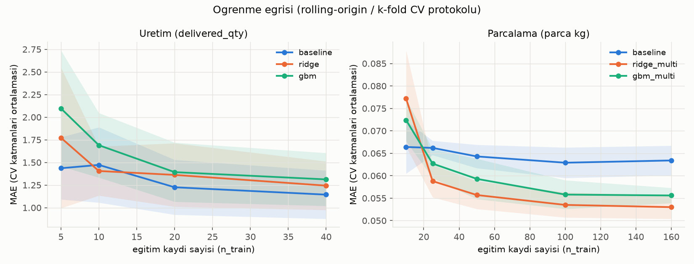
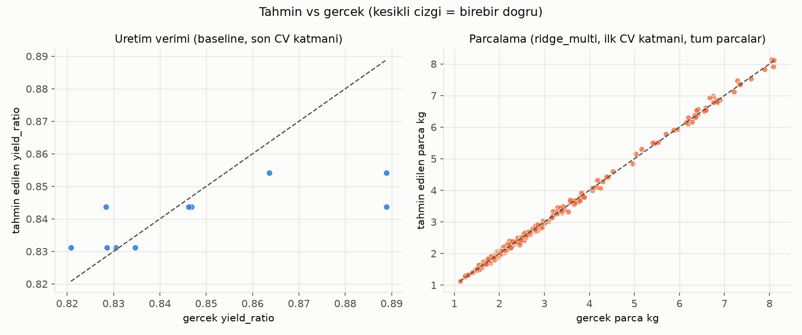
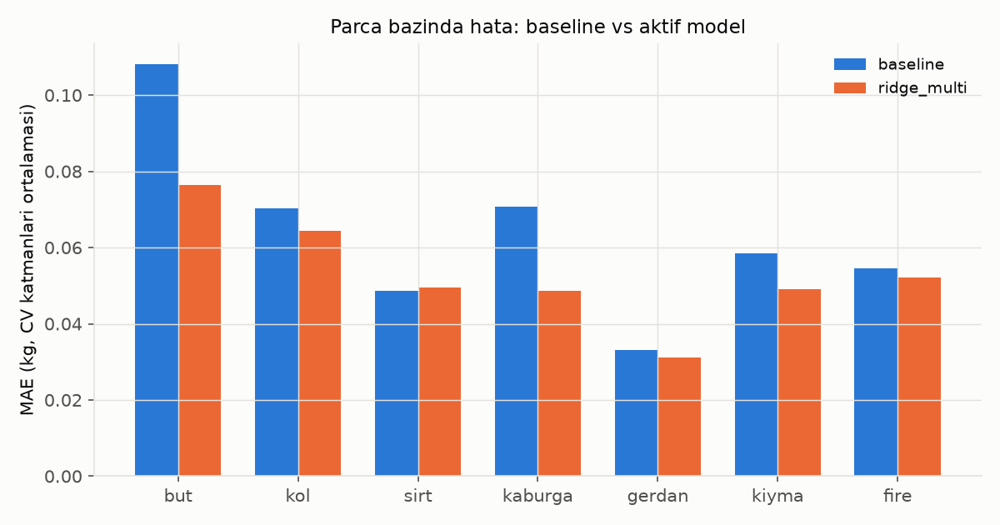
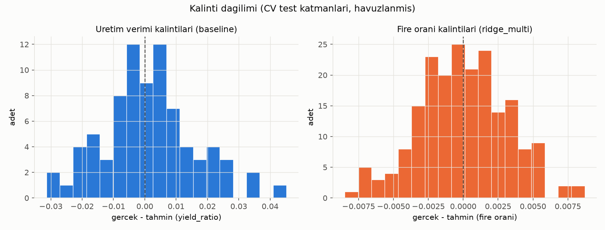

# ML Modelleri Raporu (Gorev A ve B)

> Bu rapor, yarisma dokumanindaki iki zorunlu YZ maddesi icin baseline'in yanina
> gercek modeller koyan, durust bir degerlendirme protokoluyle karsilastiran calismayi
> ozetler. **DURUSTLUK KURALI:** veri sentetiktir; metrikleri guzellestirmek icin
> gurultu azaltilmadi, veri ureteci modele yakinlastirilmadi, test seti secilmedi.
> Asagida gorulecegi gibi **bir gorevde model baseline'i gecemedi** ve bu acikca
> yazilmistir.

## 1. Problem tanimi

Yarisma dokumani iki zorunlu YZ maddesi istiyor:

- **Madde A (dis uretim):** beklenen mamul miktarini VE birim maliyetini (EKP) tahmin
  eden bir model. Burada ML servisi yalnizca fiziksel verimi (`yield_ratio` = cikti
  kg / et kg) tahmin eder; EKP tahmini Go backend'inde ML'in verim tahmini ile KESIN
  malzeme maliyetinin birlestirildigi hibrit bir formulle uretilir (bkz.
  `docs/assumptions.md` madde 11-12). Bu raporda modelin verim tahminine ek olarak, bu
  hibrit formulden turetilen EKP hatasi da olculur (bolum 4.3).
- **Madde B (parcalama):** karkastan parca basina beklenen agirligi/orani tahmin eden
  bir model.

Her iki gorev icin de "ogrenme yok, gecmis ortalama" bir **baseline** zaten vardi
(sirasiyla tedarikci bazinda ortalama verim, irk bazinda ortalama parca oranlari). Bu
iste amac, bu baseline'in yanina gercekten ogrenen modeller (Ridge, gradient boosting)
koymak ve ikisini de AYNI, durust bir protokolle karsilastirmak.

## 2. Veri

Veri tamamen sentetiktir, `ml/data/generate_production.py` ve `ml/data/generate_cutting.py`
ile uretilir (ayrintili parametre tablolari: `docs/ml-data.md`). Ozet:

| | Uretim emirleri | Kuzu parcalama |
|---|---|---|
| Kayit sayisi | 120 (bu iste 60'tan cikarildi) | 200 |
| Seed | `20250101` (sabit) | `20260101` (sabit) |
| Hedef | `delivered_qty` (adet) / `yield_ratio` (kg/kg) | parca basina kg (but, kol, sirt, kaburga, gerdan, kiyma, fire) |
| Bilinen etkiler | tedarikci, tedarikci x uretici etkilesimi, mevsim, et lotu yasi, gurultu (sigma=0,012) | irk, cinsiyet, irk x agirlik etkilesimi, gurultu (parca basina farkli sigma) |

**Neden sentetik:** Yarismada gercek isletme verisi saglanmadi. Sentetik veri, boru
hattinin (uretim, egitim, degerlendirme, servis) uctan uca calistigini ve modelin
ureteçteki BILINEN etkileri (baseline'in yakalayamadigi mevsim/etkilesim/agirlik gibi
nonlinear etkiler) yakalayip yakalayamadigini gosterir; gercek dunya performansini
KANITLAMAZ (bkz. bolum 6).

## 3. Yontem

### 3.1 Baseline (degismedi)

- **Uretim:** tedarikci bazinda gecmis ortalama verim x et_kg.
- **Parcalama:** irk bazinda ortalama parca oranlari x karkas kg, satilabilir toplam
  karkas x (1 - beklenen fire orani) olacak sekilde normalize edilir.

### 3.2 Yeni modeller

| Model | Gorev | Ozellikler | Not |
|---|---|---|---|
| `production_ridge` | A | et_kg, tedarikci (one-hot), dis uretici (one-hot), ay (sin/cos), lot yasi, baharat/bagirsak orani | StandardScaler + Ridge; alpha, GridSearchCV ile DIS CV'ye sizmadan, yalnizca o katmanin egitim verisiyle secilir |
| `production_gbm` | A | ayni ozellikler | HistGradientBoostingRegressor; az veri icin muhafazakar parametreler (max_depth=3, learning_rate=0.05, early stopping yalnizca egitim >= 20 kayitta acik) |
| `cutting_ridge_multi` | B | karkas kg, irk (one-hot), cinsiyet (one-hot), irk x agirlik etkilesimi | parca basina (but, kol, sirt, kaburga, gerdan, kiyma, fire) AYRI bir Ridge; tahminler `oracle.rounding.distribute` ile karkasa (fiziksel kisit) normalize edilir |
| `cutting_gbm_multi` | B | ayni ozellikler | parca basina ayri HistGradientBoostingRegressor, ayni normalizasyon |

Butun ogrenen modeller `yield_ratio`/parca ORANINI tahmin eder (kg degil), boylece
baseline ile ayni olcekte, dogrudan karsilastirilabilir. Backend sozlesmesi
(`/predict/production` yalnizca et_kg/supplier_id/producer_id/unit_weight_kg/order_date
gonderir) DEGISMEDI; lot_age_days/spice_kg/casing_kg gibi ek ozellikler opsiyoneldir,
verilmezse model egitim ortalamasini kullanir (bkz. `app/models/features.py`).

### 3.3 Degerlendirme protokolu (DURUSTLUK icin en onemli bolum)

**Eskiden tek bir train/test bolmesi kullaniliyordu; bu ARTIK KULLANILMIYOR** (120/200
kayitlik kucuk bir veri setinde tek bolme, hangi kayitlarin test'e dustugune asiri
duyarli, gurultulu bir sonuc verir).

- **Uretim: rolling-origin CV.** Zaman sirali, genisleyen pencere. Ilk 40 kayitla
  basla, sonraki 10 kaydi test et; egitim setini 10'ar kayit genisleterek ilerle.
  Toplam **8 katman** (egitim boyutu 40'tan 110'a, her katmanda 10 test kaydi). Zaman
  sizintisi yok: her katmanin test kayitlari, o katmanin egitim kayitlarindan DAHA
  SONRAKI tarihlidir (`train/cv.py:rolling_origin_folds`, test edilir).
- **Parcalama: 5-fold CV.** Rastgele (shuffle, sabit seed=42), kayitlari 5 esit
  parcaya bolup her birini sirayla test seti yapar.
- **Ogrenme egrisi** (bolum 5) AYNI protokolu kullanir: uretimde sabit BOYUTLU kayan
  pencere (farkli `n_train` degerleri icin ayri zaman dilimleri uzerinden ortalanir,
  boylece "egitim boyutunun etkisi" ile "hangi donemin test edildigi" karismaz),
  parcalamada 5-fold'un her birinde ic ice altkumeler (sabit seed ile).
- **Istatistiksel anlamlilik:** model ile baseline'in katman-bazli ortalama mutlak
  hatalari eslestirilip **paired t-test** uygulanir (`scipy.stats.ttest_rel`). Katman
  sayisi 3'ten azsa test anlamli sayilmaz (bu veri setinde butun gorevler >=5 katman
  oldugu icin bu durum olusmadi).
- **EKP hata metrigi** (yalnizca uretim, bolum 4.3): her test kaydi icin hibrit
  formulle (`predicted_ekp_unit = (material_cost[KESIN] + round2(predicted_qty x
  service_unit_price)) / predicted_qty`) tahmin edilen EKP, gercek EKP ile
  karsilastirilir.
- **Normalizasyon etkisi** (yalnizca `*_multi` modelleri, bolum 4.4): parca basina
  regressor'lerin HAM (karkasa toplanmasi garanti olmayan) tahminleriyle, fiziksel
  kisitla normalize edilmis NIHAI tahminlerin MAE'si ayri ayri raporlanir.

Kod: `ml/train/cv.py` (katman ureticileri + paired test), `ml/train/evaluate.py`
(protokolu her modele uygulayan ortak fonksiyonlar). Cikti: `reports/model_comparison.json`
(ozet), `reports/cv_folds.json` (katman detayi), `reports/learning_curve.json`.

## 4. Sonuclar

### 4.1 Model karsilastirma tablosu - Uretim (Madde A)

Rolling-origin CV, 8 katman, hedef `delivered_qty` (adet):

| Model | MAE (adet) | MAPE (%) | Std (katmanlar arasi) | Baseline'a gore iyilesme | p degeri |
|---|---|---|---|---|---|
| `production_baseline_supplier_mean` | **1,0835** | 1,31 | 0,2804 | - | - |
| `production_ridge` | 1,1401 | 1,38 | 0,2560 | **-%5,23** (daha kotu) | 0,249 |
| `production_gbm` | 1,2449 | 1,51 | 0,3090 | **-%14,89** (daha kotu) | 0,237 |

**Sonuc: Uretim gorevinde HICBIR ML modeli baseline'i GECEMEDI.** Fark istatistiksel
olarak da anlamli degil (p > 0,2, 0,05 esiginin cok uzerinde) -- yani gordugumuz kucuk
fark gurultu ile tamamen tutarli, gercek bir kotulesme oldugunu bile iddia edemeyiz.
Bu yuzden **aktif model baseline olarak birakildi** (`registry.DEFAULT_ACTIVE`).

**Neden boyle oldu (yorum, iddia degil):** Ureteçteki verim etkileri (tedarikci,
mevsim, etkilesim, lot yasi) kucuk genlikli (en buyugu +-0,02) ve gurultu (sigma=0,012)
bu etkilere yakin buyuklukte; 120 kayit + 8 katmanlik CV, Ridge/GBM'in bu kucuk
etkileri gurultuden ayirt edip ogrenmesi icin yeterli sinyal/gurultu orani saglamiyor
olabilir. Tedarikci bazinda ortalama almak (baseline) zaten en guclu tek etkiyi (+-0,02)
dogrudan yakaliyor; geri kalan etkiler o kadar kucuk ki ekstra ozellikler gurultuyu
ogrenme riskini (overfitting) getiriyor, sinyali degil.

### 4.2 Model karsilastirma tablosu - Parcalama (Madde B)

5-fold CV, hedef parca kg (but, kol, sirt, kaburga, gerdan, kiyma, fire):

| Model | MAE (kg) | MAPE (%) | Std (katmanlar arasi) | Baseline'a gore iyilesme | p degeri |
|---|---|---|---|---|---|
| `cutting_baseline_breed_mean` | 0,0634 | 2,29 | 0,0033 | - | - |
| `cutting_ridge_multi` | **0,0530** | **1,98** | 0,0026 | **+%16,40** | **0,0096** |
| `cutting_gbm_multi` | 0,0556 | 2,07 | 0,0017 | **+%12,36** | **0,0111** |

**Sonuc: Parcalama gorevinde her iki model de baseline'i ISTATISTIKSEL OLARAK ANLAMLI
sekilde gecti** (p < 0,05). `cutting_ridge_multi` hem daha iyi (%16,4 iyilesme) hem de
daha basit/yorumlanabilir oldugu icin **aktif model olarak secildi**.

**Neden boyle oldu:** Parcalama ureteçindeki karkas agirligi etkisi (but/kol agirlikla
duser, kaburga/kiyma artar, irka gore farkli hizda) DOGRUSAL ve carpimsal bir yapi
(irk x agirlik etkilesimi); Ridge'in ozellik kumesi (karkas kg, irk, cinsiyet, irk x
agirlik etkilesimi) bu yapiyi BIREBIR modelliyor. 200 kayit da (160 egitim/fold) bu
dogrusal iliskiyi ogrenmeye yetiyor. Bu, modelin "kendi kurdugu yapiyi yeniden
kesfetmesi" anlamina gelir (bkz. bolum 6, SINIRLILIKLAR).

### 4.3 EKP hata metrigi (yalnizca uretim)

Hibrit formulle tahmin edilen EKP'nin gercek EKP'ye ortalama mutlak hatasi (CV
katmanlari ortalamasi):

| Model | EKP MAE (EUR) | EKP MAPE (%) |
|---|---|---|
| `production_baseline_supplier_mean` | **0,1627** | 0,908 |
| `production_ridge` | 0,1713 | 0,956 |
| `production_gbm` | 0,1861 | 1,038 |

Fiziksel verim metrigiyle (4.1) tutarli: EKP hatasi da baseline'da en dusuk. Bu, Madde
A'nin "birim maliyet tahmini" kismi icin olculebilir kanit saglar; ML'in kendisi
maliyet bilmedigi icin bu metrik aslinda "ML'in verim tahmini + kesin malzeme
maliyeti" hibrit boru hattinin ucuzdan uca hata payini gosterir.

### 4.4 Normalizasyon etkisi (yalnizca parcalama *_multi modelleri)

Parca basina regressor'lerin HAM tahminleri (karkasa toplanmasi garanti degil) ile,
`oracle.rounding.distribute` ile fiziksel kisita (toplam = karkas) normalize edilmis
NIHAI tahminlerin MAE'si:

| Model | Ham MAE (kg) | Normalize MAE (kg) |
|---|---|---|
| `cutting_ridge_multi` | 0,0530 | 0,0530 |
| `cutting_gbm_multi` | 0,0556 | 0,0556 |

**Gozlem:** bu veri olceginde normalizasyonun MAE uzerindeki etkisi olculemeyecek
kadar kucuk (4 ondalikta ayni). Bunun nedeni, parca basina egitilen oranlarin
ORTALAMADA zaten ~1'e yakin toplanmasi (ureteç her kayitta oranlari 1'e normalize
ederek uretiyor, model bu yapiyi ogreniyor); normalizasyon adimi esas olarak TEK TEK
kayitlardaki kucuk tutarsizliklari duzeltiyor (ki fiziksel olarak ZORUNLU, bkz. Madde
B'nin "toplam = karkas" kisitlamasi), ortalama hatayi degil. Yani normalizasyon METRIK
icin degil, CIKTININ FIZIKSEL OLARAK GECERLI olmasi icin gerekli.

## 5. Ogrenme egrisi

Her iki grafikte de kucuk egitim boyutlarinda (uretimde n=5-10, parcalamada n=10-25)
MAE hem YUKSEK hem de katmanlar arasinda YUKSEK VARYANSLI (golgeli bant genis) --
yani az veriyle tahminler GUVENILMEZ. Parcalamada `ridge_multi` ve `gbm_multi`, n
arttikca baseline'in ALTINA iner ve stabil kalir (Madde B'nin tutarli kazanci burada
da goruluyor). Uretimde ise uc model de benzer bir aralikta kalir ve n=40'ta bile
ridge/gbm baseline'i GECEMIYOR -- 4.1'deki sonucla tutarli.

## 6. Tahmin vs gercek, parca bazinda hata, kalinti dagilimi

Sol: uretim verimi (baseline, CV'nin son katmani). Noktalar birebir-dogru cizgisinin
(kesikli) etrafinda GENIS dagiliyor -- zayif tahmin gucu, 4.1'deki sonuclarla tutarli.
Sag: parcalama (ridge_multi, ilk katman, tum parcalar). Noktalar cizgiye cok yakin --
guclu tahmin gucu.

En buyuk mutlak hata hem baseline'da hem ridge_multi'de "but" parcasinda (en buyuk
parca, dolayisiyla mutlak kg hatasi da buyuk); `ridge_multi` but, kol, kaburga ve
kiymada baseline'i acik farkla geciyor, sirt ve gerdanda neredeyse ayni.

Uretim verimi kalintilari (sol) sifir etrafinda genis ve biraz sag-carpik; parcalama
fire orani kalintilari (sag) cok daha dar ve sifir etrafinda simetrik -- iki gorev
arasindaki tahmin edilebilirlik farkini gorsel olarak dogruluyor.

## 7. SINIRLILIKLAR (kritik, lutfen okuyun)

1. **Veri sentetiktir.** Parametreler (etkiler, gurultu, olasiliklar) secilmis
   varsayimlardir, gercek isletme verisinden ogrenilmedi (bkz. `docs/ml-data.md`).
2. **Modeller, ureteçin KENDI kurdugu yapiyi yeniden kesfediyor.** Ozellikle
   parcalamada ridge_multi'nin basarisi, ureteçin dogrusal/carpimsal yapisinin
   (irk x agirlik etkilesimi) Ridge'in varsayimlarina (dogrusallik) tam oturmasindandir.
   Bu, GERCEK dunyada ayni basarinin tekrarlanacagini KANITLAMAZ -- gercek karkas
   parcalama iliskileri bu kadar temiz dogrusal olmayabilir.
3. **Gercek dunya performansi KANITLANMIS DEGILDIR.** Bu raporun tum metrikleri
   sentetik veri uzerindedir; gercek veriyle yeniden egitim ve degerlendirme olmadan
   uretimde guvenilir sayilamaz.
4. **Gurultu tabani nedeniyle MAE'nin inebilecegi bir ALT SINIR vardir, baseline zaten
   ona yakin.** Uretimde gurultu sigma=0,012 (yield_ratio biriminde); hicbir model,
   sistematik (tahmin edilebilir) sinyali tukettikten sonra bu gurultuyu daha fazla
   azaltamaz. Baseline'in MAE'si (1,08 adet) zaten bu tabana yakinsa, Ridge/GBM'in
   onu GECEMEMESI sasirtici degildir (bkz. 4.1 yorumu).
5. **Az veriyle (5-20 kayit) tahminler guvenilmez, ogrenme egrisi (bolum 5) bunu
   gosteriyor.** Katmanlar arasi std bu boljede en yuksek.
6. **Lot izlenebilirligi ve geri cagirma sonuclari ML'E DAYANMAZ, kesin kayit
   iliskilerine dayanir.** `docs/traceability.md`'de belgelendigi gibi, Gorev 3
   servisi (`repo/traceability.go`) ML istemcisine hic referans vermez; tum
   entegrasyon testleri ML kapaliyken de gecer. Bu rapordaki ML sinirliliklari
   izlenebilirlik/geri cagirma dogrulugunu ETKILEMEZ.
7. **Anomali tespiti (opsiyonel ozellik) de bu sinirliliklara tabidir.** `VERIM_DUSUK`/
   `FIRE_YUKSEK` kurallarinin sigma esikleri sentetik veri uzerinden hesaplanan CV
   kalinti standart sapmalaridir (bkz. `docs/anomaly-integration.md`).

## 8. Gercek veriye gecis

Gercek isletme verisiyle yeniden egitim icin minimum gereksinimler:

- **Uretim:** her dis uretim emri icin gercek `et_kg`, tedarikci/uretici kimligi, et
  lotu alis/kullanim tarihleri (lot yasi icin), baharat/bagirsak sarfiyati, VE
  gerceklesen `delivered_qty`. Mevsimsellik ve tedarikci etkilerinin anlamli
  olcülebilmesi icin **en az 2 tam yillik, haftada bir uretim ritminde ~100+ kayit**
  (bu raporun kullandigi hacimle ayni buyuklukte) onerilir; rolling-origin CV'nin
  8 katiminin anlamli kalmasi icin bu asagi inilmemelidir.
- **Parcalama:** her kuzu icin irk, cinsiyet, karkas agirligi VE gerceklesen parca
  agirliklari (but, kol, sirt, kaburga, gerdan, kiyma, fire). **En az 150-200 kayit**
  (5-fold CV'nin her katmaninda >=30 test kaydi kalmasi icin) onerilir; irk basina en
  az 30-40 kayit olmazsa irk x agirlik etkilesimi guvenilir tahmin edilemez.
- **Ikisi icin de:** zaman damgali, duzenli araliklarla toplanan veri (rolling-origin
  CV'nin anlamli olmasi icin), ve mumkunse ML tahmini ile gerceklesen sonuc arasindaki
  sapmanin (bu raporun EKP/verim hata metrikleri gibi) SUREKLI izlenmesi -- boylece
  model zamanla (`train.train_models` yeniden calistirilarak) gercek veriyle
  guncellenebilir.
