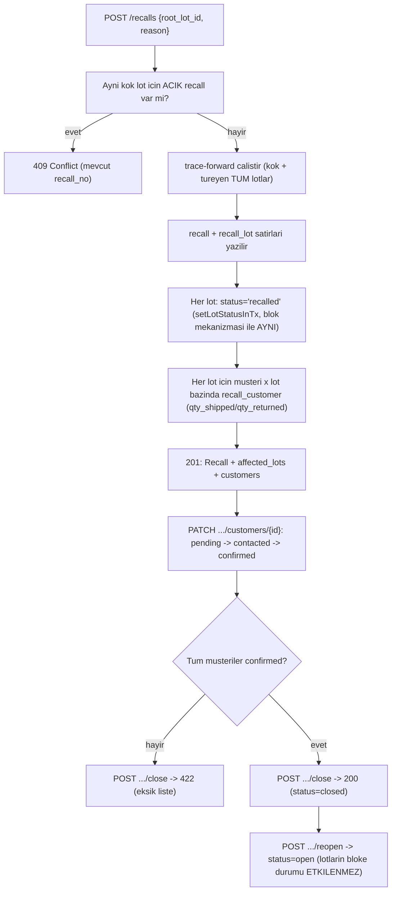

# İzlenebilirlik ve geri çağırma (Görev 3)

Uygulama: `backend/internal/repo/traceability.go` (sorgular + geri çağırma servisi),
`backend/internal/domain/traceability.go` (API JSON tipleri), uç noktalar `backend/internal/http/traceability_handlers.go`.
Sözleşme: [`docs/api-contract.md`](api-contract.md) ("İzlenebilirlik" ve "Geri çağırma" bölümleri),
`backend/api/openapi.yaml`.

**KRİTİK:** bu dosyadaki hiçbir sorgu veya hesap ML'e dayanmaz. İzlenebilirlik ve geri çağırma sonuçları
yalnızca **kesin kayıt ilişkilerinden** (`lot_link`, `sales_line`, `shipment_line`, `customer_return`)
hesaplanır. `backend/internal/integration/traceability_test.go` bu testlerin hepsini ML servisi
**kapalıyken** (Store'a hiçbir ML istemcisi bağlanmadan) çalıştırır.

## 1. Veri modeli: `lot_link` (çoktan çoğa, miktarlı soy ağacı)

```
lot_link(id, parent_lot_id, child_lot_id, qty_from_parent, uom, process_type, process_id, created_at)
```

- Her satır **tek bir kenardır**: `parent_lot_id` lotundan `qty_from_parent` miktarı, `process_type`
  (`production|cutting|reprocess|repack`) + `process_id` (ilgili işlem/sipariş kaydının id'si) ile
  `child_lot_id` lotuna aktarılmıştır.
- **Çoktan çoğa**: bir mamul lotu birden fazla hammadde lotundan türeyebilir (SUC-2026-045 ← ET + BHR +
  BGR, üç ayrı `lot_link` satırı) VE bir hammadde lotu birden fazla mamul lotuna dağılabilir
  (seed'de ET-2026-002 → SUC-2026-046 **ve** SUC-2026-047, iki ayrı `lot_link` satırı — bkz. aşağı). Bu yüzden şema **ayrı bir `lot.parent_id` kolonu değil**, kendi tablosudur.
- `lot_link` yazan servisler: `ReceiveProduction` (dış üretim, `process_type='production'`),
  `CloseCuttingOrder` (parçalama, `'cutting'`) ve `CreateReprocessOrder` (yeniden işleme, `'reprocess'`,
  migration `000012`, `POST /reprocess-orders`). Yeniden işlemede girdi lotları `reprocess_consume` ile
  tüketilir, yeni lot `reprocess_in` ile girer ve her girdi için bir kenar yazılır; ileri/geri izleme
  ve geri çağırma bu yüzden yeniden işlenmiş lotları **ek kod olmadan** kapsar (`TestReprocessOrder`).
  `repack` için servis yoktur (PDF'de geçmez). Döngü/derinlik testleri (`TestTraceForwardThreeLevelsDeep`,
  `TestTraceForwardCycleGuard`) kenarları doğrudan `lot_link` satırı ekleyerek kurar.
- Lot bazında kaydedilen diğer hareketler: depo transferi (`transfer_out`/`transfer_in`,
  `POST /stock-transfers`), satış, iade ve **fire** (`waste_out`, `POST /lots/{id}/waste`; geri
  çağrılmış lotun imhası da bu yoldur). Hepsi `GET /stock-movements` ve web'deki **Stok Hareketleri**
  sayfasında lot bazında listelenir.

## 2. Recursive CTE'ler (MySQL 8 `WITH RECURSIVE`)

Sabit kodlama yok: her şey `lot_link` üzerinden graf gezilerek hesaplanır. İki yön için simetrik iki CTE
(`backend/internal/repo/traceability.go`, `forwardCTE`/`backwardCTE`):

```sql
-- ileri (parent -> child)
WITH RECURSIVE fwd AS (
  SELECT l.id AS lot_id, 0 AS depth, CAST(l.id AS CHAR(4000)) AS path, NULL ...
  FROM lot l WHERE l.id = ?                      -- kök (depth=0)
  UNION ALL
  SELECT ll.child_lot_id, fwd.depth + 1, CONCAT(fwd.path, ',', ll.child_lot_id), ll.parent_lot_id, ...
  FROM lot_link ll JOIN fwd ON fwd.lot_id = ll.parent_lot_id
  WHERE NOT FIND_IN_SET(ll.child_lot_id, fwd.path) -- DÖNGÜ KORUMASI
)
SELECT ... FROM fwd
```

- **Döngü koruması:** `path` sütunu kökten o düğüme kadar ziyaret edilen TÜM lot id'lerinin virgülle
  ayrılmış listesidir; `WHERE NOT FIND_IN_SET(...)` bir lotun **aynı dalda** ikinci kez ziyaret
  edilmesini engeller. Gerçek hayatta `lot_link` bir DAG'dır (döngü oluşmaz: bir lot kendi atasından
  üretilemez), ama test (`TestTraceForwardCycleGuard`) yapay bir `A→B→A` döngüsü kurup sorgunun sonsuza
  girmediğini, tam 2 düğümle (A, B) döndüğünü doğrular.
- **Çok yollu:** aynı kenar kümesi üzerinde frontier genişlemesi olduğu için bir lot BİRDEN FAZLA
  ebeveynden (trace-forward'da farklı dallardan) ulaşılabilir; her kenar kendi satırıdır. Düğüm listesi
  (tekil lot başına bir giriş) için çağıran taraf `lot_id` bazında **en küçük `depth`** olan kenarı
  birincil kabul eder (`fetchForwardEdges`'in döndürdüğü kenarlar `ORDER BY depth, lot_id` sıralıdır).
- **Çok seviyeli:** `depth` sınırsız artar (MySQL'in varsayılan `cte_max_recursion_depth=1000` yeterli);
  `TestTraceForwardThreeLevelsDeep` 3 seviye derinliği (`L1→L2→L3→L4`) doğrular.
- Geri izleme CTE'si simetriktir (`child_lot_id` üzerinden `bwd.lot_id = ll.child_lot_id` ile yukarı
  gezinir), aynı döngü korumasını kullanır.
- `genealogy` uç noktası HER İKİ CTE'yi de çalıştırıp `level` (negatif=yukarı, 0=kök, pozitif=aşağı) ile
  birleştirir; web'de basit bir hiyerarşik ağaç (seviye bazlı satırlar + kenar tablosu) olarak çizilir.

## 3. İleri izleme akışı ve ikinci kademe dağıtım kuralı

`trace-forward`, kök dahil her düğüm için GÜNCEL verileri (sorgudan SONRA, repo katmanında) toplar:

1. `getLot(..., withDetail=true)` → depo bazlı bakiye (`v_lot_balance`).
2. `shipment_line`/`shipment`/`customer` → sevkiyatlar.
3. `sales_line`/`sales_order`/`customer` → satışlar (`recall_violation` bayrağıyla; offline bloke lot
   satışları burada kırmızı rozetle ayrılır, bkz. `docs/sync.md` "OFFLINE KURALI").
4. `customer_return` → iade edilen miktar (satılan miktardan **düşülmez**, ayrı `returned_qty` alanında
   gösterilir — "kalan risk" hesaplaması web'de `qty_shipped - qty_returned` ile yapılır).

Müşteri bazlı özet (`summary.customers`) bu düğümlerin satış satırlarından toplanır. **İkinci kademe
dağıtım kuralı** (PDF: "İkinci kademe dağıtım yalnızca kaydedilmişse kesin olarak gösterilir"): marketin
kendi alıcılarına dağıttığı miktar `downstream_distribution` tablosuna (`POST /downstream-distributions`,
web: Geri Çağırma detayında "+") kaydedilebilir. Toplam kayıt, müşteriye o lottan giden net miktarı
(sevk − iade) aşamaz (`422`).

- **Kayıt yoksa:** `downstream_known=false`, `downstream` boş, `downstream_note` sabit açıklama
  ("İkinci kademe dağıtım kaydı yok, market ile iletişime geçilmeli"). Uydurma rakam üretilmez.
- **Kayıt varsa:** `downstream_known=true` ve kayıtlı alıcılar miktarlarıyla `downstream` listesinde
  kesin olarak gösterilir. Kayıtlar net miktarı karşılamıyorsa kalan kısım için not döner
  (`DownstreamPartialNoteText`); kayıtsız kısım için yine rakam uydurulmaz.

Aynı kayıtlar geri çağırmanın müşteri satırlarında (`customers[].downstream`) ve iletişim listesi
CSV'sinde (`kademe=2`, `dagitan_musteri` dolu satırlar) yer alır.

## 4. Geri çağırma akışı



- **Bloke mekanizması yeniden kullanılır:** `setLotStatusInTx` (eski `SetLotBlocked`'tan çıkarılan ortak
  yardımcı), `POST /lots/{id}/block` ile AYNI deseni (durum + `blocked_reason` güncelle, `change_log`'a
  TAM lot görünümünü yaz) `status='recalled'` için kullanır. `blocked_reason = "<recall_no>: <reason>"`.
  `GET /sync/pull`'daki `blocked_lot_ids` (`status IN ('blocked','recalled')`) bu yüzden hiçbir ek
  değişiklik gerektirmeden etkilenen lotları otomatik içerir.
- **`qty_shipped` kaynağı:** `sales_line` (her satışın `customer_id`'si `sales_order` üzerinden) BİRLEŞİMİ
  siparişe bağlı olmayan `shipment_line` (`shipment.sales_order_id IS NULL`) ile. Bu kod tabanında her
  satış zaten bir sevkiyat doğurduğu için (bkz. `docs/assumptions.md` Satış/sevkiyat bölümü), pratikte
  kaynak `sales_line`'dır; birleşim yalnızca ileride sipariş dışı sevkiyat eklenirse veri kaybını önler.
- **Offline ihlal görünürlüğü:** `recall_customer` görünümündeki `has_violation`, o müşterinin o lottan
  `sales_line.recall_violation=TRUE` olan (yani recall AÇILDIKTAN SONRA `/sync/push` ile gelen bloke lot
  satışı) satırını işaretler; web'de kırmızı "offline ihlal" rozetiyle ayrı gösterilir. İşaret müşteri
  bazındadır: aynı lotu önceden almış diğer marketlere yansımaz.
- **Geri çağırma listesi geç satışlarla güncellenir:** `/sync/push` ile geri çağrılan lota düşen satış,
  satışla aynı transaction'da `syncRecallCustomersForLot` çağırır. Mevcut müşterinin `qty_shipped`'i artar
  ve `contact_status` tekrar `pending` olur; listede olmayan müşteri için yeni satır açılır (iletişim
  listesi/CSV'ye de girer). Geri çağırma kapatılmışsa yeniden `open` olur, çünkü haber verilmemiş riskli
  ürün varken kapalı kalamaz. Geri çağırma sonrası iade yalnız açık geri çağırmada `qty_returned`'ü
  günceller; iletişim durumunu değiştirmez, kapalı geri çağırmayı açmaz.

## 5. ET-2026-001 senaryosu — adım adım beklenen çıktı

Seed (`backend/cmd/seed/main.go`, servisler üzerinden), yarışma dokümanıyla birebir: `ET-2026-001`
(100 kg et) `URT-2026-045`'te (baharat+bağırsakla birlikte) kullanılır → 85 paket `SUC-2026-045` →
Market A/B/C 30/25/30. Ondan TAMAMEN ayrı ikinci bir et lotu `ET-2026-002` (32 kg) dokümandaki "bir
hammadde lotu birden fazla mamul lotuna dönüşebilir" ilişkisini gösterir: 12 kg `URT-2026-046` →
10 adet `SUC-2026-046` (Market A), 20 kg `URT-2026-047` → 10 adet `SUC-2026-047` (Market C).

| Lot | Hammadde | Market A | Market B | Market C |
|---|---|---|---|---|
| SUC-2026-045 | ET-2026-001 | 30 | 25 (−2 iade) | 30 |
| SUC-2026-046 | ET-2026-002 | 10 | — | — |
| SUC-2026-047 | ET-2026-002 | — | — | 10 |

1. `GET /lots?q=ET-2026-001` → lot id bulunur.
2. `GET /lots/{id}/trace-forward` → `nodes`: `ET-2026-001` (depth 0), `SUC-2026-045` (depth 1, 100 kg).
   **`SUC-2026-046`/`SUC-2026-047` listede YOKTUR** (başka et lotundan). `summary.customers`: Market A
   **30**, Market B **25** (iade 2 AYRI gösterilir), Market C **30**.
3. `POST /recalls {root_lot_id, reason}` → `affected_lot_count=2`, `ET-2026-001` ve `SUC-2026-045`
   `recalled` olur (`SUC-2026-046`/`SUC-2026-047` `active` kalır), `customers` listesi Market A/B/C
   satırlarını içerir.
4. `GET /sync/pull?since_seq=0` → `blocked_lot_ids` iki lotu da içerir.
5. O lottan REST ile satış denemesi `422 LOT_BLOCKED`; `/sync/push` ile (offline) gönderilirse
   `flagged` + `LOT_BLOCKED_AT_SALE`; o müşterinin `recall_customer` satırında `has_violation=true`,
   `qty_shipped` satışla artar, müşteri listede yoksa eklenir ve `contact_status` `pending` olur.
6. `PATCH .../customers/{id}` ile her müşteri `confirmed` yapılır; `POST .../close` → `closed`.
7. `GET /recalls/{id}/contact-list?format=csv` → market/telefon/mail/lot/sevk/iade/durum CSV.

Entegrasyon testleri (`backend/internal/integration/traceability_test.go`) bu TÜM adımları gerçek MySQL'e
karşı doğrular (`TestTraceForwardMultiPathAndCustomerSummary`, `TestTraceBackwardThreeRawLotsThreeSuppliers`,
`TestGenealogyLevelsAndEdges`, `TestRecallCreateBlocksOnlyAffectedLots`,
`TestRecallCloseRequiresAllCustomersConfirmed`, `TestRecallBlockReflectedInSyncAndOfflineViolation`,
`TestRecallContactListCSV`, `TestTraceForwardCycleGuard`, `TestTraceForwardThreeLevelsDeep`).
